# Mapa do Front-end & Estrutura Modular Mobile (React Native / Expo)

## 📌 1. Visão Geral da Arquitetura Front-end

O aplicativo mobile institucional do IFAM foi projetado utilizando **React Native + Expo**, seguindo o padrão arquitetural **Feature-First / Domain-Driven (Hub & Spoke)**.

A aplicação desacopla a lógica e as telas de cada setor institucional em módulos independentes, compartilhando um núcleo central (**Core Shared**) para autenticação única (**SSO**), tema visual (**Design System V2**), cliente HTTP (**Axios**) e componentes transversais (leitor de QR Code, seletores de data/hora e badges).

---

## 📂 2. Estrutura Modular de Pastas (`frontend-ifam/`)

Abaixo está a árvore completa de diretórios recomendada para o projeto React Native no ambiente de produção:

```text
frontend-ifam/
│
├── assets/                             # Recursos estáticos globais
│   ├── fonts/                          # Tipografia institucional personalizada
│   ├── icons/                          # Ícones do aplicativo (app icon, favicon)
│   └── images/                         # Logomarcas do IFAM (logo_ifam_01.png, splash.png)
│
├── src/
│   ├── core/                           # NÚCLEO COMPARTILHADO (Transversal a todos os módulos)
│   │   ├── components/                 # Componentes de UI genéricos e reutilizáveis
│   │   │   ├── ButtonIF.js             # Botões com estilos do Design System V2
│   │   │   ├── CardContainer.js        # Card padrão com elevação e bordas arredondadas
│   │   │   ├── BadgeStatus.js          # Badges coloridos de status em coluna
│   │   │   ├── HeaderPrincipal.js      # Cabeçalho verde com logo e perfil
│   │   │   ├── IfamLogo.js             # Logomarca vetorial nativa do IFAM
│   │   │   ├── DateTimeInput.js        # Seletor nativo de data e hora (iOS/Android)
│   │   │   └── QRScannerView.js        # Visor com mira estilizada para leitura de QR Code
│   │   │
│   │   ├── theme/                      # Identidade visual e constantes de design
│   │   │   ├── colors.js               # Paleta de cores oficial (Verde IF, Vermelho, Amarelo, Azul)
│   │   │   ├── typography.js           # Tamanhos de fonte e pesos tipográficos
│   │   │   └── shadows.js              # Sombras multiplataforma (iOS shadow / Android elevation)
│   │   │
│   │   ├── services/                   # Camada de comunicação com a API RESTful
│   │   │   ├── api.js                  # Instância configurada do Axios com baseURL
│   │   │   └── interceptors.js         # Injeção automática do Bearer Token JWT e tratamento de erros
│   │   │
│   │   ├── context/                    # Estado global compartilhado
│   │   │   ├── AuthContext.js          # Contexto de autenticação, perfil e dados do usuário logado
│   │   │   └── NotificationContext.js  # Controle de notificações não lidas e alertas in-app
│   │   │
│   │   ├── hooks/                      # Hooks customizados transversais
│   │   │   ├── useAuth.js              # Acesso rápido ao estado de login/logout e permissões
│   │   │   └── useNotifications.js     # Hook para busca e leitura de alertas
│   │   │
│   │   └── utils/                      # Funções utilitárias e formatadores
│   │       ├── dateUtils.js            # Formatação de datas (DD/MM/AAAA) e horários (HH:mm)
│   │       ├── validationUtils.js      # Validação de e-mail institucional e matrícula/SIAPE
│   │       └── storageUtils.js         # Persistência segura local (AsyncStorage / SecureStore)
│   │
│   ├── navigation/                     # Estrutura de roteamento e navegação (React Navigation)
│   │   ├── AppNavigator.js             # Roteador Raiz (Alterna entre AuthStack e MainStack)
│   │   ├── AuthNavigator.js            # Pilha de telas de Acesso (Login e Recuperação de Senha)
│   │   ├── HubNavigator.js             # Navegação da Vitrine de Módulos (Menu Principal Geral)
│   │   ├── EquipamentosNavigator.js    # Pilha do Módulo 1 (Empréstimos e Inventário)
│   │   └── LaboratoriosNavigator.js    # Pilha do Módulo 2 (Alocação de Labs)
│   │
│   └── modules/                        # MÓDULOS DE NEGÓCIO DA INSTITUIÇÃO
│       │
│       ├── auth/                       # Domínio de Acesso e Perfil
│       │   ├── screens/                # LoginScreen, RecuperarSenhaScreen, PerfilNotificacoesScreen
│       │   └── services/               # authService.js (login, recuperação, refresh)
│       │
│       ├── hub/                        # Domínio do Hub Institucional (Vitrine Super App)
│       │   ├── screens/                # HubModulosScreen (Vitrine dos módulos com atalhos rápidos)
│       │   └── components/             # ModuleCard.js, InfoBanner.js
│       │
│       ├── equipamentos/               # MÓDULO 1: Empréstimo de Equipamentos & Inventário
│       │   ├── screens/                # CatalogoSolicitanteScreen, MeusEmprestimosScreen,
│       │   │                           # DashboardAdminScreen, AprovacoesPendentesScreen,
│       │   │                           # CheckOutScreen, CheckInScreen, InventarioAdminScreen,
│       │   │                           # CadastroRecursoScreen, TiposRecursoScreen,
│       │   │                           # CrudUsuariosScreen, HistoricoGlobalAdminScreen
│       │   ├── components/             # ModalReservaEquipamento.js, ModalChecklistAvarias.js
│       │   └── services/               # equipamentosService.js (CRUD recursos, reservas, checkout/in)
│       │
│       └── laboratorios/               # MÓDULO 2: Alocação & Gestão de Laboratórios
│           ├── screens/                # MenuLaboratoriosScreen, CatalogoLaboratoriosScreen,
│           │                           # GestaoSoftwaresScreen, GradeHorariosScreen,
│           │                           # SolicitacaoAlocacaoLabScreen, AprovacoesAlocacoesScreen,
│           │                           # CheckinLabScreen, ChecklistFechamentoLabScreen,
│           │                           # DashboardLaboratoriosScreen
│           ├── components/             # ModalFichaTecnicaLab.js, GradeSlotsGrid.js,
│           │                           # ChecklistFechamentoView.js, SoftwareChipSelector.js
│           └── services/               # laboratoriosService.js (salas, softwares, grades, alocações)
│
├── screen/                             # ARQUIVOS PROTOTIPADOS (Standalones para teste no Expo Snack)
├── logo/                               # Imagens originais de logomarca institucional
├── docs/                               # Documentação e especificações de contexto
├── app.json                            # Configurações do ecossistema Expo
├── package.json                        # Dependências e scripts do projeto Node
├── babel.config.js                     # Configuração de transpilador Babel
└── App.js                              # Ponto de entrada (Entry Point) da aplicação
```

---

## 🗺️ 3. Diagrama do Fluxo de Navegação (React Navigation)

```mermaid
flowchart TD
    App[App.js • Entrada] --> RootNav[RootNavigator]
    
    RootNav -->|Não Autenticado| AuthStack[AuthNavigator]
    AuthStack --> Login[LoginScreen]
    AuthStack --> RecSenha[RecuperarSenhaScreen]

    RootNav -->|Autenticado| HubStack[HubNavigator]
    HubStack --> HubScreen[HubModulosScreen • Vitrine de Módulos]
    HubStack --> Perfil[PerfilNotificacoesScreen]

    HubScreen -->|Seleciona Módulo 1| Mod1Stack[EquipamentosNavigator]
    subgraph "Módulo 1: Equipamentos & TI"
        Mod1Stack --> MenuEq[MenuPrincipalScreen]
        MenuEq --> CatEq[CatalogoSolicitanteScreen]
        MenuEq --> MeusEmp[MeusEmprestimosScreen]
        MenuEq --> DashEq[DashboardAdminScreen]
        MenuEq --> AprovEq[AprovacoesPendentesScreen]
        MenuEq --> OutQR[CheckOutScreen]
        MenuEq --> InQR[CheckInScreen]
        MenuEq --> InvEq[InventarioAdminScreen]
        MenuEq --> CadRec[CadastroRecursoScreen]
        MenuEq --> TiposRec[TiposRecursoScreen]
        MenuEq --> CrudUser[CrudUsuariosScreen]
        MenuEq --> HistEq[HistoricoGlobalAdminScreen]
    end

    HubScreen -->|Seleciona Módulo 2| Mod2Stack[LaboratoriosNavigator]
    subgraph "Módulo 2: Laboratórios de Informática"
        Mod2Stack --> MenuLab[MenuLaboratoriosScreen]
        MenuLab --> CatLab[CatalogoLaboratoriosScreen]
        MenuLab --> SoftLab[GestaoSoftwaresScreen]
        MenuLab --> GradeLab[GradeHorariosScreen]
        MenuLab --> SolLab[SolicitacaoAlocacaoLabScreen]
        MenuLab --> AprovLab[AprovacoesAlocacoesScreen]
        MenuLab --> CheckInPorta[CheckinLabScreen]
        MenuLab --> FechamentoLab[ChecklistFechamentoLabScreen]
        MenuLab --> DashLab[DashboardLaboratoriosScreen]
    end
```



---

## 📋 4. Mapeamento Completo das Telas e Componentes

Total de Telas Prototipadas: **25 Telas Principais + 1 Utilitário** (localizadas na pasta [`screen/`](file:///c:/IFAM/2026/DSDM/Prototipo/screen)):

### 🏛️ 4.1. Acesso & Hub Geral de Módulos (Portal IFAM)
| Nº | Arquivo em `screen/` | Requisito | Perfil | Responsabilidade da Tela |
| :---: | :--- | :--- | :--- | :--- |
| **01** | [`login_screen.js`](file:///c:/IFAM/2026/DSDM/Prototipo/screen/login_screen.js) | `RF-CORE01` | Todos | Autenticação por e-mail institucional ou matrícula/SIAPE e senha com logo vetorial do IFAM. |
| **02** | [`recuperar_senha_screen.js`](file:///c:/IFAM/2026/DSDM/Prototipo/screen/recuperar_senha_screen.js) | `RF-CORE02` | Todos | Envio de token/link de redefinição de senha com validação visual de formato. |
| **03** | [`perfil_notificacoes_screen.js`](file:///c:/IFAM/2026/DSDM/Prototipo/screen/perfil_notificacoes_screen.js) | `RF-CORE03` | Todos | Central de notificações in-app filtrada por módulo e dados do perfil logado. |
| **04** | [`hub_modulos_screen.js`](file:///c:/IFAM/2026/DSDM/Prototipo/screen/hub_modulos_screen.js) | `RF-CORE04` | Todos | **Hub Central de Módulos (Vitrine do Super App)** com atalhos contextuais rápidos. |

---

### 📦 4.2. Módulo 1: Empréstimo de Equipamentos & Inventário (Suporte/TI)
| Nº | Arquivo em `screen/` | Requisito | Perfil | Responsabilidade da Tela |
| :---: | :--- | :--- | :--- | :--- |
| **05** | [`menu_principal_screen.js`](file:///c:/IFAM/2026/DSDM/Prototipo/screen/menu_principal_screen.js) | `RF-EQ01` | Ambos | Menu do Módulo de Equipamentos com alternador de perfil (*Solicitante / Administrador*). |
| **06** | [`catalogo_solicitante_screen.js`](file:///c:/IFAM/2026/DSDM/Prototipo/screen/catalogo_solicitante_screen.js) | `RF-EQ03` | Solicitante | Catálogo de itens disponíveis com DateTimePicker nativo e modal de agendamento. |
| **07** | [`meus_emprestimos_screen.js`](file:///c:/IFAM/2026/DSDM/Prototipo/screen/meus_emprestimos_screen.js) | `RF-EQ07` | Solicitante | Histórico de reservas pessoais com prazos de devolução e status do pedido. |
| **08** | [`dashboard_admin_screen.js`](file:///c:/IFAM/2026/DSDM/Prototipo/screen/dashboard_admin_screen.js) | `RF-EQ08` | Admin | Painel de KPIs de equipamentos (emprestados, pendências, manutenções e atrasos). |
| **09** | [`aprovacoes_pendentes_screen.js`](file:///c:/IFAM/2026/DSDM/Prototipo/screen/aprovacoes_pendentes_screen.js) | `RF-EQ04` | Admin | Fila de aprovações com layout de badges em coluna e modal de justificativa de recusa. |
| **10** | [`check_out_screen.js`](file:///c:/IFAM/2026/DSDM/Prototipo/screen/check_out_screen.js) | `RF-EQ05` | Admin | Scanner de saída física via QR Code com validação de agendamento aprovado. |
| **11** | [`check_in_screen.js`](file:///c:/IFAM/2026/DSDM/Prototipo/screen/check_in_screen.js) | `RF-EQ06` | Admin | Scanner de devolução via QR Code com checklist de avarias e observações. |
| **12** | [`inventario_admin_screen.js`](file:///c:/IFAM/2026/DSDM/Prototipo/screen/inventario_admin_screen.js) | `RF-EQ02` | Admin | Listagem e controle de estado de conservação de todos os itens tombados. |
| **13** | [`cadastro_recurso_screen.js`](file:///c:/IFAM/2026/DSDM/Prototipo/screen/cadastro_recurso_screen.js) | `RF-EQ02` | Admin | Formulário de cadastro de novo patrimônio com gerador visual de QR Code. |
| **14** | [`tipos_recurso_screen.js`](file:///c:/IFAM/2026/DSDM/Prototipo/screen/tipos_recurso_screen.js) | `RF-EQ01` | Admin | Modal CRUD de categorias e modelos de equipamentos. |
| **15** | [`crud_usuarios_screen.js`](file:///c:/IFAM/2026/DSDM/Prototipo/screen/crud_usuarios_screen.js) | `RF-CORE05` | Admin | Gestão de usuários, alteração de perfis e desbloqueio/bloqueio manual de contas. |
| **16** | [`historico_global_admin_screen.js`](file:///c:/IFAM/2026/DSDM/Prototipo/screen/historico_global_admin_screen.js) | `RF-EQ07` | Admin | Histórico geral de movimentações com filtros por período e status da reserva. |

---

### 💻 4.3. Módulo 2: Alocação e Gestão de Laboratórios de Informática
| Nº | Arquivo em `screen/` | Requisito | Perfil | Responsabilidade da Tela |
| :---: | :--- | :--- | :--- | :--- |
| **17** | [`menu_laboratorios_screen.js`](file:///c:/IFAM/2026/DSDM/Prototipo/screen/menu_laboratorios_screen.js) | `Hub Mod 2` | Ambos | Menu do Módulo de Laboratórios com alternador de perfil e atalhos prioritários. |
| **18** | [`catalogo_laboratorios_screen.js`](file:///c:/IFAM/2026/DSDM/Prototipo/screen/catalogo_laboratorios_screen.js) | `RF-LAB01` | Ambos | Catálogo com busca por softwares, filtros por bloco/SO e **Ficha Técnica Detalhada**. |
| **19** | [`gestao_softwares_screen.js`](file:///c:/IFAM/2026/DSDM/Prototipo/screen/gestao_softwares_screen.js) | `RF-LAB02` | Admin | Painel para CRUD de softwares, versões e vinculação direta aos laboratórios. |
| **20** | [`grade_horarios_screen.js`](file:///c:/IFAM/2026/DSDM/Prototipo/screen/grade_horarios_screen.js) | `RF-LAB03` | Ambos | Matriz visual de disponibilidade por turno (*Matutino, Vespertino, Noturno*) e tempos de aula. |
| **21** | [`solicitacao_alocacao_lab_screen.js`](file:///c:/IFAM/2026/DSDM/Prototipo/screen/solicitacao_alocacao_lab_screen.js) | `RF-LAB04` | Solicitante | Formulário de reserva para aula pontual ou semestral com validação de capacidade. |
| **22** | [`aprovacoes_alocacoes_screen.js`](file:///c:/IFAM/2026/DSDM/Prototipo/screen/aprovacoes_alocacoes_screen.js) | `RF-LAB05` | Admin | Painel de aprovações com **detector visual de conflitos de grade** e recusa justificada. |
| **23** | [`checkin_lab_screen.js`](file:///c:/IFAM/2026/DSDM/Prototipo/screen/checkin_lab_screen.js) | `RF-LAB06` | Ambos | Scanner de QR Code na porta do laboratório para validação de presença e abertura. |
| **24** | [`checklist_fechamento_lab_screen.js`](file:///c:/IFAM/2026/DSDM/Prototipo/screen/checklist_fechamento_lab_screen.js) | `RF-LAB07` | Ambos | Vistoria pós-aula (máquinas, ar-condicionado, projetor, periféricos e portas). |
| **25** | [`dashboard_laboratorios_screen.js`](file:///c:/IFAM/2026/DSDM/Prototipo/screen/dashboard_laboratorios_screen.js) | `RF-LAB08` | Admin | Dashboard gerencial com taxa de ocupação, gráfico por turno e ranking de demanda. |

---

### 🔍 4.4. Componentes Utilitários Compartilhados
| Nº | Arquivo em `screen/` | Perfil | Responsabilidade do Componente |
| :---: | :--- | :--- | :--- |
| **26** | [`scanner_screen.js`](file:///c:/IFAM/2026/DSDM/Prototipo/screen/scanner_screen.js) | Ambos | Leitor de câmera para decodificação de QR Codes patrimoniais e de portas. |

---

## 📲 5. Como Testar e Executar as Telas

### Opção A: Execução Imediata via Expo Snack (Sem Instalação Local)
1. Instale o aplicativo **Expo Go** no seu celular:
   * **Android:** Google Play Store
   * **iOS:** Utilize a câmera nativa do iPhone.
2. Acesse a plataforma oficial: [`https://snack.expo.dev/`](https://snack.expo.dev/)
3. Abra qualquer arquivo da pasta [`screen/`](file:///c:/IFAM/2026/DSDM/Prototipo/screen) no editor, copie todo o seu conteúdo e cole dentro do arquivo `App.js` no Snack.
4. Clique no botão **Run on device** no canto superior direito para gerar o QR Code.
5. Escaneie o QR Code no seu celular para interagir com o protótipo ao vivo.

### Opção B: Execução Local no Projeto React Native (`frontend-ifam/`)
```bash
# 1. Instalar as dependências do projeto
npm install

# 2. Iniciar o servidor de desenvolvimento do Expo
npx expo start

# 3. Pressionar 'a' para emulador Android, 'i' para iOS ou escanear o terminal com o Expo Go
```