# Modelagem de Banco de Dados (Plataforma Multi-Módulos)

**Motor:** PostgreSQL 15+  
**Padrão de Chaves Primárias:** UUID v4 (`uuid-ossp`)  
**Estratégia de Tipagem:** Enums Nativos para integridade de status e integridade referencial com chaves estrangeiras (`ON DELETE RESTRICT / CASCADE`).

---

## 🗺️ 1. Diagrama de Entidade e Relacionamento (DER Completo)

Abaixo está o mapeamento visual unificado de todas as entidades dos módulos institucionais do IFAM:

```mermaid
erDiagram
    %% ==========================================
    %% RELACIONAMENTOS CENTRAIS (CORE)
    %% ==========================================
    usuarios ||--o{ notificacoes : "recebe alertas (1:N)"
    
    %% ==========================================
    %% RELACIONAMENTOS MÓDULO 1: EQUIPAMENTOS
    %% ==========================================
    usuarios ||--o{ reservas : "solicita empréstimo (1:N)"
    tipos_recursos ||--o{ recursos : "classifica (1:N)"
    recursos ||--o{ reservas : "é alocado em (1:N)"

    %% ==========================================
    %% RELACIONAMENTOS MÓDULO 2: LABORATÓRIOS
    %% ==========================================
    usuarios ||--o{ alocacoes_laboratorios : "solicita alocação de lab (1:N)"
    laboratorios ||--o{ softwares_laboratorio : "possui instalado (1:N)"
    laboratorios ||--o{ alocacoes_laboratorios : "é reservado em (1:N)"
    grades_horarios ||--o{ alocacoes_laboratorios : "define horário da aula (1:N)"

    %% ==========================================
    %% TABELAS CORE
    %% ==========================================
    usuarios {
        UUID id_usuario PK "Identificador único"
        VARCHAR nome_completo "Nome institucional"
        VARCHAR email "E-mail @ifam.edu.br (UNIQUE)"
        VARCHAR senha_hash "Senha criptografada (Bcrypt)"
        VARCHAR identificacao_institucional "Matrícula/SIAPE (UNIQUE)"
        ENUM perfil "Solicitante, Administrador"
        ENUM status_conta "Ativo, Bloqueado_por_Atraso, Inativo"
        TIMESTAMP criado_em "Data de criação"
        TIMESTAMP atualizado_em "Última alteração"
    }

    notificacoes {
        UUID id_notificacao PK "Identificador único"
        UUID id_usuario FK "Destinatário"
        VARCHAR modulo_origem "EQUIPAMENTOS, LABORATORIOS, SISTEMA"
        ENUM tipo_evento "Reserva_Aprovada, Alerta_Atraso, etc."
        TEXT mensagem_corpo "Texto descritivo do alerta"
        BOOLEAN status_leitura "Flag de leitura (true/false)"
        TIMESTAMP data_hora_envio "Momento da emissão"
    }

    %% ==========================================
    %% TABELAS MÓDULO 1: EQUIPAMENTOS & TI
    %% ==========================================
    tipos_recursos {
        UUID id_tipo_recurso PK "Identificador único"
        VARCHAR descricao "ex: Datashow Epson 3000 lumens"
        VARCHAR categoria "Eletrônicos, Cabos, Acessórios"
        TIMESTAMP criado_em "Data de cadastro"
    }

    recursos {
        UUID id_recurso PK "Identificador único"
        UUID id_tipo_recurso FK "Referência à Categoria"
        VARCHAR codigo_patrimonio "Tombamento IFAM (UNIQUE)"
        VARCHAR marca_modelo "Marca e modelo físico"
        ENUM estado_conservacao "Novo, Bom, Regular, Defeito"
        ENUM status_disponibilidade "Disponível, Emprestado, Manutenção"
        VARCHAR qr_code_hash "Hash seguro para validação (UNIQUE)"
        TIMESTAMP criado_em "Data de cadastro"
        TIMESTAMP atualizado_em "Última atualização"
    }

    reservas {
        UUID id_reserva PK "Identificador único"
        UUID id_usuario FK "Solicitante"
        UUID id_recurso FK "Equipamento físico"
        TIMESTAMP data_hora_prevista_retirada "Agendamento saída"
        TIMESTAMP data_hora_prevista_devolucao "Agendamento retorno"
        TIMESTAMP data_hora_efetiva_retirada "Check-out via QR Code"
        TIMESTAMP data_hora_efetiva_devolucao "Check-in via QR Code"
        ENUM status_reserva "Pendente, Aprovada, Em_Andamento, Concluido, Atrasado, Rejeitada, Cancelada"
        TEXT justificativa_rejeicao "Motivo em caso de recusa"
        ENUM checklist_devolucao "Estado avaliado no check-in"
        TEXT observacoes "Avarias ou comentários"
        TIMESTAMP criado_em "Data do pedido"
        TIMESTAMP atualizado_em "Última alteração"
    }

    %% ==========================================
    %% TABELAS MÓDULO 2: LABORATÓRIOS
    %% ==========================================
    laboratorios {
        UUID id_laboratorio PK "Identificador único"
        VARCHAR nome_laboratorio "ex: Lab 01 - Redes"
        VARCHAR bloco_predio "ex: Bloco B - 1º Andar (Sala 102)"
        INT capacidade_computadores "ex: 32"
        VARCHAR sistema_operacional "Linux, Windows, Dual Boot"
        TEXT especificacao_hardware "i5, 16GB RAM, SSD 512GB"
        ENUM status_laboratorio "Disponivel, Ocupado, Manutencao, Interditado"
        VARCHAR qr_code_porta_hash "Hash seguro da porta (UNIQUE)"
        TIMESTAMP criado_em "Data de cadastro"
        TIMESTAMP atualizado_em "Última atualização"
    }

    softwares_laboratorio {
        UUID id_software PK "Identificador único"
        UUID id_laboratorio FK "Laboratório onde está instalado"
        VARCHAR nome_software "ex: Cisco Packet Tracer"
        VARCHAR versao "ex: 8.2.1"
        VARCHAR categoria "Desenvolvimento, Redes, CAD, etc."
        VARCHAR tipo_licenca "Open Source, Educacional, Comercial"
        TIMESTAMP criado_em "Data de cadastro"
    }

    grades_horarios {
        UUID id_grade_horario PK "Identificador único"
        ENUM turno "Matutino, Vespertino, Noturno"
        VARCHAR descricao_tempo "ex: 1º e 2º Tempo (07:30 - 09:10)"
        TIME hora_inicio "07:30:00"
        TIME hora_fim "09:10:00"
    }

    alocacoes_laboratorios {
        UUID id_alocacao PK "Identificador único"
        UUID id_usuario FK "Professor Solicitante"
        UUID id_laboratorio FK "Laboratório alocado"
        UUID id_grade_horario FK "Slot de tempo"
        DATE data_reserva "Data da aula"
        VARCHAR dia_semana "Segunda, Terça, etc."
        VARCHAR disciplina "ex: Redes de Computadores I"
        VARCHAR curso_turma "ex: TADS 4º Período"
        INT qtd_alunos_prevista "Quantidade estimada de alunos"
        ENUM tipo_alocacao "Pontual, Semestral"
        ENUM status_alocacao "Pendente, Aprovada, Em_Uso, Concluida, Rejeitada, Cancelada"
        TEXT softwares_solicitados "Lista de softwares necessários"
        TEXT justificativa_rejeicao "Motivo da recusa pelo Admin"
        TIMESTAMP data_hora_checkin "Momento do QR na porta"
        TIMESTAMP data_hora_fechamento "Momento da vistoria pós-aula"
        ENUM estado_conservacao_pos_aula "Excelente, Bom, Avarias_Leves, Critico"
        TEXT checklist_fechamento_obs "Relato de máquinas e periféricos"
        TIMESTAMP criado_em "Data da solicitação"
        TIMESTAMP atualizado_em "Última alteração"
    }
```



---

## 📖 2. Dicionário de Dados Detalhado

### 2.1. Tabela: `usuarios` (Core / SSO)
Armazena as contas institucionais unificadas.

| Coluna | Tipo | Restrição | Descrição |
| :--- | :--- | :--- | :--- |
| `id_usuario` | `UUID` | PK | Identificador único universal do usuário. |
| `nome_completo` | `VARCHAR(150)` | NOT NULL | Nome civil institucional. |
| `email` | `VARCHAR(150)` | UNIQUE, NOT NULL | E-mail institucional `@ifam.edu.br`. |
| `senha_hash` | `VARCHAR(255)` | NOT NULL | Hash seguro (Bcrypt). |
| `identificacao_institucional` | `VARCHAR(50)` | UNIQUE, NOT NULL | Matrícula do Aluno ou SIAPE do Servidor/Professor. |
| `perfil` | `ENUM perfil_usuario` | DEFAULT 'Solicitante' | `Solicitante` ou `Administrador`. |
| `status_conta` | `ENUM status_conta` | DEFAULT 'Ativo' | `Ativo`, `Bloqueado_por_Atraso`, `Inativo`. |
| `criado_em` | `TIMESTAMP TZ` | DEFAULT NOW() | Data/hora de registro. |
| `atualizado_em` | `TIMESTAMP TZ` | DEFAULT NOW() | Data/hora da última alteração. |

---

### 2.2. Tabela: `notificacoes` (Core)
Alertas unificados para todos os módulos da aplicação.

| Coluna | Tipo | Restrição | Descrição |
| :--- | :--- | :--- | :--- |
| `id_notificacao` | `UUID` | PK | Identificador único do alerta. |
| `id_usuario` | `UUID` | FK, NOT NULL | Destinatário da notificação (`ON DELETE CASCADE`). |
| `modulo_origem` | `VARCHAR(50)` | NOT NULL | Módulo gerador: `EQUIPAMENTOS`, `LABORATORIOS`, `SISTEMA`. |
| `tipo_evento` | `ENUM tipo_notificacao` | NOT NULL | Tipo de evento visual. |
| `mensagem_corpo` | `TEXT` | NOT NULL | Conteúdo informativo do alerta. |
| `status_leitura` | `BOOLEAN` | DEFAULT FALSE | Flag indicativa de leitura. |
| `data_hora_envio` | `TIMESTAMP TZ` | DEFAULT NOW() | Momento da emissão do alerta. |

---

### 2.3. Tabela: `tipos_recursos` (Módulo 1)
Categorias e especificações técnicas de equipamentos.

| Coluna | Tipo | Restrição | Descrição |
| :--- | :--- | :--- | :--- |
| `id_tipo_recurso` | `UUID` | PK | Identificador único da categoria. |
| `descricao` | `VARCHAR(150)` | NOT NULL | Nome do modelo (ex: "Datashow Epson 3000 lumens"). |
| `categoria` | `VARCHAR(100)` | NOT NULL | Família: "Eletrônicos", "Cabos", "Acessórios". |
| `criado_em` | `TIMESTAMP TZ` | DEFAULT NOW() | Data de cadastro. |

---

### 2.4. Tabela: `recursos` (Módulo 1)
Itens físicos de inventário que recebem etiqueta de QR Code.

| Coluna | Tipo | Restrição | Descrição |
| :--- | :--- | :--- | :--- |
| `id_recurso` | `UUID` | PK | Identificador único do item físico. |
| `id_tipo_recurso` | `UUID` | FK, NOT NULL | Categoria associada (`ON DELETE RESTRICT`). |
| `codigo_patrimonio` | `VARCHAR(50)` | UNIQUE, NOT NULL | Tombamento oficial do IFAM (ex: "PAT-102030"). |
| `marca_modelo` | `VARCHAR(150)` | NOT NULL | Marca e modelo físico detalhado. |
| `estado_conservacao` | `ENUM estado_conservacao` | DEFAULT 'Bom' | `Novo`, `Bom`, `Regular`, `Defeito`. |
| `status_disponibilidade` | `ENUM status_recurso` | DEFAULT 'Disponível' | `Disponível`, `Emprestado`, `Manutenção`. |
| `qr_code_hash` | `VARCHAR(255)` | UNIQUE, NOT NULL | Hash de segurança para validação por câmera. |
| `criado_em` | `TIMESTAMP TZ` | DEFAULT NOW() | Data de tombamento. |
| `atualizado_em` | `TIMESTAMP TZ` | DEFAULT NOW() | Data da última movimentação. |

---

### 2.5. Tabela: `reservas` (Módulo 1)
Movimentações operacionais de empréstimo de equipamentos.

| Coluna | Tipo | Restrição | Descrição |
| :--- | :--- | :--- | :--- |
| `id_reserva` | `UUID` | PK | Identificador único da transação de reserva. |
| `id_usuario` | `UUID` | FK, NOT NULL | Solicitante (`ON DELETE RESTRICT`). |
| `id_recurso` | `UUID` | FK, NOT NULL | Equipamento reservado (`ON DELETE RESTRICT`). |
| `data_hora_prevista_retirada` | `TIMESTAMP TZ` | NOT NULL | Agendamento de saída (Check-out). |
| `data_hora_prevista_devolucao` | `TIMESTAMP TZ` | NOT NULL | Prazo limite de devolução (Check-in). |
| `data_hora_efetiva_retirada` | `TIMESTAMP TZ` | NULL | Momento real do check-out via QR Code pelo Admin. |
| `data_hora_efetiva_devolucao` | `TIMESTAMP TZ` | NULL | Momento real do check-in via QR Code pelo Admin. |
| `status_reserva` | `ENUM status_reserva` | DEFAULT 'Pendente' | Etapa atual do fluxo operacional. |
| `justificativa_rejeicao` | `TEXT` | NULL | Justificativa do Admin caso seja rejeitada. |
| `checklist_devolucao` | `ENUM estado_conservacao` | NULL | Avaliação física do item no ato da devolução. |
| `observacoes` | `TEXT` | NULL | Relato livre de avarias ou atrasos. |
| `criado_em` | `TIMESTAMP TZ` | DEFAULT NOW() | Data de submissão do pedido. |
| `atualizado_em` | `TIMESTAMP TZ` | DEFAULT NOW() | Data da última alteração de status. |

---

### 2.6. Tabela: `laboratorios` (Módulo 2)
Salas e laboratórios físicos de informática da instituição.

| Coluna | Tipo | Restrição | Descrição |
| :--- | :--- | :--- | :--- |
| `id_laboratorio` | `UUID` | PK | Identificador único do laboratório. |
| `nome_laboratorio` | `VARCHAR(150)` | NOT NULL | Nome da sala (ex: "Laboratório 01 - Redes"). |
| `bloco_predio` | `VARCHAR(150)` | NOT NULL | Localização (ex: "Bloco B - 1º Andar, Sala 102"). |
| `capacidade_computadores` | `INT` | NOT NULL | Quantidade de postos de trabalho para alunos. |
| `sistema_operacional` | `VARCHAR(100)` | NOT NULL | "Linux Ubuntu", "Windows 11", "Dual Boot". |
| `especificacao_hardware` | `TEXT` | NOT NULL | Detalhes de processador, memória RAM e SSD. |
| `status_laboratorio` | `ENUM status_laboratorio` | DEFAULT 'Disponivel' | `Disponivel`, `Ocupado`, `Manutencao`, `Interditado`. |
| `qr_code_porta_hash` | `VARCHAR(255)` | UNIQUE, NOT NULL | Hash da plaqueta fixada na porta para check-in. |
| `criado_em` | `TIMESTAMP TZ` | DEFAULT NOW() | Data de cadastro. |
| `atualizado_em` | `TIMESTAMP TZ` | DEFAULT NOW() | Data da última atualização. |

---

### 2.7. Tabela: `softwares_laboratorio` (Módulo 2)
Programas e ferramentas instaladas em cada laboratório.

| Coluna | Tipo | Restrição | Descrição |
| :--- | :--- | :--- | :--- |
| `id_software` | `UUID` | PK | Identificador único do software instalado. |
| `id_laboratorio` | `UUID` | FK, NOT NULL | Laboratório vinculado (`ON DELETE CASCADE`). |
| `nome_software` | `VARCHAR(150)` | NOT NULL | Nome do programa (ex: "Cisco Packet Tracer"). |
| `versao` | `VARCHAR(50)` | NOT NULL | Versão instalada (ex: "v8.2.1"). |
| `categoria` | `VARCHAR(100)` | NOT NULL | "Desenvolvimento", "Redes", "Design & CAD". |
| `tipo_licenca` | `VARCHAR(100)` | DEFAULT 'Open Source' | Tipo de licenciamento. |
| `criado_em` | `TIMESTAMP TZ` | DEFAULT NOW() | Data de registro. |

---

### 2.8. Tabela: `grades_horarios` (Módulo 2)
Tabela de tempos de aula e turnos institucionais padronizados.

| Coluna | Tipo | Restrição | Descrição |
| :--- | :--- | :--- | :--- |
| `id_grade_horario` | `UUID` | PK | Identificador do slot de tempo. |
| `turno` | `ENUM turno_alocacao` | NOT NULL | `Matutino`, `Vespertino`, `Noturno`. |
| `descricao_tempo` | `VARCHAR(100)` | NOT NULL | ex: "1º e 2º Tempo (07:30 - 09:10)". |
| `hora_inicio` | `TIME` | NOT NULL | Horário de início (ex: `07:30:00`). |
| `hora_fim` | `TIME` | NOT NULL | Horário de término (ex: `09:10:00`). |

---

### 2.9. Tabela: `alocacoes_laboratorios` (Módulo 2)
Agendamento, autorização e vistoria de uso dos laboratórios.

| Coluna | Tipo | Restrição | Descrição |
| :--- | :--- | :--- | :--- |
| `id_alocacao` | `UUID` | PK | Identificador único do agendamento de sala. |
| `id_usuario` | `UUID` | FK, NOT NULL | Docente solicitante (`ON DELETE RESTRICT`). |
| `id_laboratorio` | `UUID` | FK, NOT NULL | Laboratório solicitado (`ON DELETE RESTRICT`). |
| `id_grade_horario` | `UUID` | FK, NOT NULL | Slot de tempo (`ON DELETE RESTRICT`). |
| `data_reserva` | `DATE` | NOT NULL | Data da aula ou início do semestre. |
| `dia_semana` | `VARCHAR(20)` | NOT NULL | "Segunda-feira", "Terça-feira", etc. |
| `disciplina` | `VARCHAR(150)` | NOT NULL | Nome da disciplina acadêmica. |
| `curso_turma` | `VARCHAR(150)` | NOT NULL | Curso e período (ex: "TADS 4º Período"). |
| `qtd_alunos_prevista` | `INT` | NOT NULL | Estimativa de alunos na aula prática. |
| `tipo_alocacao` | `ENUM tipo_alocacao_lab` | DEFAULT 'Pontual' | `Pontual` ou `Semestral`. |
| `status_alocacao` | `ENUM status_alocacao_lab` | DEFAULT 'Pendente' | Etapa atual do fluxo de alocação. |
| `softwares_solicitados` | `TEXT` | NULL | Lista de softwares necessários. |
| `justificativa_rejeicao` | `TEXT` | NULL | Motivo de recusa preenchido pelo Admin. |
| `data_hora_checkin` | `TIMESTAMP TZ` | NULL | Momento em que o QR Code da porta foi lido. |
| `data_hora_fechamento` | `TIMESTAMP TZ` | NULL | Momento em que o checklist de saída foi enviado. |
| `estado_conservacao_pos_aula`| `ENUM estado_pos_aula` | NULL | Avaliação pós-aula: `Excelente`, `Bom`, etc. |
| `checklist_fechamento_obs` | `TEXT` | NULL | Relato de computadores ou avarias na sala. |
| `criado_em` | `TIMESTAMP TZ` | DEFAULT NOW() | Data do pedido. |
| `atualizado_em` | `TIMESTAMP TZ` | DEFAULT NOW() | Data da última alteração. |

---

## 💻 3. Script DDL PostgreSQL Completo e Executável

```sql
-- ========================================================
-- SCRIPT DE CRIAÇÃO DO BANCO DE DADOS: PORTAL MULTI-MÓDULOS IFAM
-- MOTOR: PostgreSQL 15+
-- ========================================================

-- Habilitar extensão para geração de UUIDs v4
CREATE EXTENSION IF NOT EXISTS "uuid-ossp";

-- ========================================================
-- 1. CRIAÇÃO DOS TIPOS ENUMERADOS (ENUMS)
-- ========================================================
CREATE TYPE perfil_usuario AS ENUM ('Solicitante', 'Administrador');
CREATE TYPE status_conta AS ENUM ('Ativo', 'Bloqueado_por_Atraso', 'Inativo');
CREATE TYPE tipo_notificacao AS ENUM ('Reserva_Aprovada', 'Lembrete_Devolucao', 'Alerta_Atraso', 'Reserva_Rejeitada', 'Alocacao_Aprovada', 'Alocacao_Rejeitada', 'Lembrete_Aula_Lab', 'Sistema');

-- Enums Módulo 1 (Equipamentos)
CREATE TYPE estado_conservacao AS ENUM ('Novo', 'Bom', 'Regular', 'Defeito');
CREATE TYPE status_recurso AS ENUM ('Disponível', 'Emprestado', 'Manutenção');
CREATE TYPE status_reserva AS ENUM ('Pendente', 'Aprovada', 'Rejeitada', 'Em_Andamento', 'Concluido', 'Atrasado', 'Cancelada');

-- Enums Módulo 2 (Laboratórios)
CREATE TYPE status_laboratorio AS ENUM ('Disponivel', 'Ocupado', 'Manutencao', 'Interditado');
CREATE TYPE turno_alocacao AS ENUM ('Matutino', 'Vespertino', 'Noturno');
CREATE TYPE tipo_alocacao_lab AS ENUM ('Pontual', 'Semestral');
CREATE TYPE status_alocacao_lab AS ENUM ('Pendente', 'Aprovada', 'Em_Uso', 'Concluida', 'Rejeitada', 'Cancelada');
CREATE TYPE estado_pos_aula AS ENUM ('Excelente', 'Bom', 'Avarias_Leves', 'Critico');

-- ========================================================
-- 2. TABELAS CORE / COMPARTILHADAS
-- ========================================================

-- Tabela: usuarios
CREATE TABLE usuarios (
    id_usuario UUID PRIMARY KEY DEFAULT uuid_generate_v4(),
    nome_completo VARCHAR(150) NOT NULL,
    email VARCHAR(150) UNIQUE NOT NULL,
    senha_hash VARCHAR(255) NOT NULL,
    identificacao_institucional VARCHAR(50) UNIQUE NOT NULL,
    perfil perfil_usuario DEFAULT 'Solicitante' NOT NULL,
    status_conta status_conta DEFAULT 'Ativo' NOT NULL,
    criado_em TIMESTAMP WITH TIME ZONE DEFAULT CURRENT_TIMESTAMP NOT NULL,
    atualizado_em TIMESTAMP WITH TIME ZONE DEFAULT CURRENT_TIMESTAMP NOT NULL
);

-- Tabela: notificacoes
CREATE TABLE notificacoes (
    id_notificacao UUID PRIMARY KEY DEFAULT uuid_generate_v4(),
    id_usuario UUID NOT NULL REFERENCES usuarios(id_usuario) ON DELETE CASCADE,
    modulo_origem VARCHAR(50) NOT NULL,
    tipo_evento tipo_notificacao NOT NULL,
    mensagem_corpo TEXT NOT NULL,
    status_leitura BOOLEAN DEFAULT FALSE NOT NULL,
    data_hora_envio TIMESTAMP WITH TIME ZONE DEFAULT CURRENT_TIMESTAMP NOT NULL
);

-- ========================================================
-- 3. TABELAS DO MÓDULO 1: EQUIPAMENTOS E INVENTÁRIO
-- ========================================================

-- Tabela: tipos_recursos
CREATE TABLE tipos_recursos (
    id_tipo_recurso UUID PRIMARY KEY DEFAULT uuid_generate_v4(),
    descricao VARCHAR(150) NOT NULL,
    categoria VARCHAR(100) NOT NULL,
    criado_em TIMESTAMP WITH TIME ZONE DEFAULT CURRENT_TIMESTAMP NOT NULL
);

-- Tabela: recursos
CREATE TABLE recursos (
    id_recurso UUID PRIMARY KEY DEFAULT uuid_generate_v4(),
    id_tipo_recurso UUID NOT NULL REFERENCES tipos_recursos(id_tipo_recurso) ON DELETE RESTRICT,
    codigo_patrimonio VARCHAR(50) UNIQUE NOT NULL,
    marca_modelo VARCHAR(150) NOT NULL,
    estado_conservacao estado_conservacao DEFAULT 'Bom' NOT NULL,
    status_disponibilidade status_recurso DEFAULT 'Disponível' NOT NULL,
    qr_code_hash VARCHAR(255) UNIQUE NOT NULL,
    criado_em TIMESTAMP WITH TIME ZONE DEFAULT CURRENT_TIMESTAMP NOT NULL,
    atualizado_em TIMESTAMP WITH TIME ZONE DEFAULT CURRENT_TIMESTAMP NOT NULL
);

-- Tabela: reservas
CREATE TABLE reservas (
    id_reserva UUID PRIMARY KEY DEFAULT uuid_generate_v4(),
    id_usuario UUID NOT NULL REFERENCES usuarios(id_usuario) ON DELETE RESTRICT,
    id_recurso UUID NOT NULL REFERENCES recursos(id_recurso) ON DELETE RESTRICT,
    data_hora_prevista_retirada TIMESTAMP WITH TIME ZONE NOT NULL,
    data_hora_prevista_devolucao TIMESTAMP WITH TIME ZONE NOT NULL,
    data_hora_efetiva_retirada TIMESTAMP WITH TIME ZONE,
    data_hora_efetiva_devolucao TIMESTAMP WITH TIME ZONE,
    status_reserva status_reserva DEFAULT 'Pendente' NOT NULL,
    justificativa_rejeicao TEXT,
    checklist_devolucao estado_conservacao,
    observacoes TEXT,
    criado_em TIMESTAMP WITH TIME ZONE DEFAULT CURRENT_TIMESTAMP NOT NULL,
    atualizado_em TIMESTAMP WITH TIME ZONE DEFAULT CURRENT_TIMESTAMP NOT NULL
);

-- ========================================================
-- 4. TABELAS DO MÓDULO 2: LABORATÓRIOS DE INFORMÁTICA
-- ========================================================

-- Tabela: laboratorios
CREATE TABLE laboratorios (
    id_laboratorio UUID PRIMARY KEY DEFAULT uuid_generate_v4(),
    nome_laboratorio VARCHAR(150) NOT NULL,
    bloco_predio VARCHAR(150) NOT NULL,
    capacidade_computadores INT NOT NULL,
    sistema_operacional VARCHAR(100) NOT NULL,
    especificacao_hardware TEXT NOT NULL,
    status_laboratorio status_laboratorio DEFAULT 'Disponivel' NOT NULL,
    qr_code_porta_hash VARCHAR(255) UNIQUE NOT NULL,
    criado_em TIMESTAMP WITH TIME ZONE DEFAULT CURRENT_TIMESTAMP NOT NULL,
    atualizado_em TIMESTAMP WITH TIME ZONE DEFAULT CURRENT_TIMESTAMP NOT NULL
);

-- Tabela: softwares_laboratorio
CREATE TABLE softwares_laboratorio (
    id_software UUID PRIMARY KEY DEFAULT uuid_generate_v4(),
    id_laboratorio UUID NOT NULL REFERENCES laboratorios(id_laboratorio) ON DELETE CASCADE,
    nome_software VARCHAR(150) NOT NULL,
    versao VARCHAR(50) NOT NULL,
    categoria VARCHAR(100) NOT NULL,
    tipo_licenca VARCHAR(100) DEFAULT 'Open Source' NOT NULL,
    criado_em TIMESTAMP WITH TIME ZONE DEFAULT CURRENT_TIMESTAMP NOT NULL
);

-- Tabela: grades_horarios
CREATE TABLE grades_horarios (
    id_grade_horario UUID PRIMARY KEY DEFAULT uuid_generate_v4(),
    turno turno_alocacao NOT NULL,
    descricao_tempo VARCHAR(100) NOT NULL,
    hora_inicio TIME NOT NULL,
    hora_fim TIME NOT NULL
);

-- Tabela: alocacoes_laboratorios
CREATE TABLE alocacoes_laboratorios (
    id_alocacao UUID PRIMARY KEY DEFAULT uuid_generate_v4(),
    id_usuario UUID NOT NULL REFERENCES usuarios(id_usuario) ON DELETE RESTRICT,
    id_laboratorio UUID NOT NULL REFERENCES laboratorios(id_laboratorio) ON DELETE RESTRICT,
    id_grade_horario UUID NOT NULL REFERENCES grades_horarios(id_grade_horario) ON DELETE RESTRICT,
    data_reserva DATE NOT NULL,
    dia_semana VARCHAR(20) NOT NULL,
    disciplina VARCHAR(150) NOT NULL,
    curso_turma VARCHAR(150) NOT NULL,
    qtd_alunos_prevista INT NOT NULL,
    tipo_alocacao tipo_alocacao_lab DEFAULT 'Pontual' NOT NULL,
    status_alocacao status_alocacao_lab DEFAULT 'Pendente' NOT NULL,
    softwares_solicitados TEXT,
    justificativa_rejeicao TEXT,
    data_hora_checkin TIMESTAMP WITH TIME ZONE,
    data_hora_fechamento TIMESTAMP WITH TIME ZONE,
    estado_conservacao_pos_aula estado_pos_aula,
    checklist_fechamento_obs TEXT,
    criado_em TIMESTAMP WITH TIME ZONE DEFAULT CURRENT_TIMESTAMP NOT NULL,
    atualizado_em TIMESTAMP WITH TIME ZONE DEFAULT CURRENT_TIMESTAMP NOT NULL
);

-- ========================================================
-- 5. ÍNDICES DE PERFORMANCE E BUSCA
-- ========================================================
CREATE INDEX idx_usuarios_email ON usuarios(email);
CREATE INDEX idx_usuarios_matricula ON usuarios(identificacao_institucional);
CREATE INDEX idx_recursos_patrimonio ON recursos(codigo_patrimonio);
CREATE INDEX idx_recursos_qr_hash ON recursos(qr_code_hash);
CREATE INDEX idx_reservas_status ON reservas(status_reserva);
CREATE INDEX idx_reservas_datas ON reservas(data_hora_prevista_retirada, data_hora_prevista_devolucao);

CREATE INDEX idx_labs_qr_porta ON laboratorios(qr_code_porta_hash);
CREATE INDEX idx_alocacoes_data_lab ON alocacoes_laboratorios(data_reserva, id_laboratorio, id_grade_horario);
CREATE INDEX idx_alocacoes_status ON alocacoes_laboratorios(status_alocacao);
CREATE INDEX idx_notificacoes_usuario_lida ON notificacoes(id_usuario, status_leitura);
```