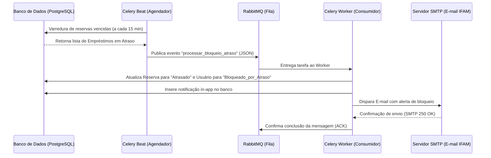

# Arquitetura de Mensageria e Tarefas em Segundo Plano (Multi-Módulos)

## 📌 1. Visão Geral

Para garantir alta velocidade e disponibilidade na API RESTful (FastAPI), todos os processos baseados em tempo, varreduras periódicas, validações de atraso e envios de e-mails são processados de forma assíncrona.

A arquitetura utiliza o **RabbitMQ** como message broker de alta confiabilidade, gerenciado por workers do **Celery** e agendamentos periódicos do **Celery Beat**.

---

## 🛠️ 2. Componentes da Arquitetura

```
┌─────────────────┐       ┌─────────────────┐       ┌─────────────────┐
│   Celery Beat   │       │   FastAPI API   │       │   PostgreSQL    │
│  (Agendador)    │       │(Eventos Sínc.)  │       │(Banco de Dados) │
└────────┬────────┘       └────────┬────────┘       └────────▲────────┘
         │                         │                         │
         └────────────┬────────────┘                         │
                      ▼                                      │
         ┌─────────────────────────┐                         │
         │   RabbitMQ (Broker)     │                         │
         │   • Filas por Domínio   │                         │
         └────────────┬────────────┘                         │
                      │                                      │
                      ▼                                      │
         ┌─────────────────────────┐                         │
         │     Celery Workers      │─────────────────────────┘
         │ (Consumidores Tarefas)  │
         └────────────┬────────────┘
                      │
                      ▼
         ┌─────────────────────────┐
         │ Servidor SMTP / E-mail  │
         │ (Disparo Transacional)  │
         └─────────────────────────┘
```

| Componente | Tecnologia | Responsabilidade |
| :--- | :--- | :--- |
| **Agendador Periódico** | `Celery Beat` | Executa rotinas automáticas em intervalos regulares (ex: varredura de atrasos a cada 15 min; lembretes diários às 08:00). |
| **Message Broker** | `RabbitMQ` | Gerencia o enfileiramento das mensagens com persistência em disco e garantia de entrega (ACK). |
| **Trabalhadores** | `Celery Workers` | Processam tarefas pesadas em segundo plano, atualizam status no banco e registram notificações in-app. |
| **Envio de E-mail** | `FastAPI-Mail` + `SMTP` | Conecta-se ao servidor SMTP institucional para envio de e-mails em HTML. |

---

## 🚦 3. Organização das Filas de Mensageria

### 📦 3.1. Filas do Módulo 1 (Equipamentos & TI)

#### Fila: `fila_atrasos_bloqueios_equipamentos`
* **Gatilho:** Celery Beat (a cada 15 minutos).
* **Processamento:**
  1. Identifica empréstimos com `data_hora_prevista_devolucao < NOW()` e status `Em_Andamento`.
  2. Atualiza `status_reserva` para `Atrasado`.
  3. Atualiza `status_conta` do usuário para `Bloqueado_por_Atraso` (Regra **RN03**).
  4. Insere notificação in-app (`Alerta_Atraso`) na tabela `notificacoes`.
  5. Enfileira o disparo de e-mail de cobrança urgente.

#### Fila: `fila_lembretes_devolucao_equipamentos`
* **Gatilho:** Celery Beat (diariamente às 08:00).
* **Processamento:** Notifica usuários com devoluções previstas para o próprio dia (`Lembrete_Devolucao`).

---

### 💻 3.2. Filas do Módulo 2 (Laboratórios de Informática)

#### Fila: `fila_lembretes_aulas_labs`
* **Gatilho:** Celery Beat (diariamente às 07:00).
* **Processamento:** Envia lembrete ao docente com a sala confirmada, turno e instruções de check-in via QR Code na porta.

#### Fila: `fila_alertas_conflitos_labs`
* **Gatilho:** FastAPI (ao cadastrar solicitação semestral).
* **Processamento:** Analisa sobreposição de grades e notifica a coordenação de TI para resolução antecipada.

---

### 🌐 3.3. Filas Globais / Transacionais

#### Fila: `fila_emails_transacionais`
* **Gatilho:** FastAPI (Eventos em tempo real).
* **Processamento:** Disparo imediato de e-mails de confirmação de cadastro, aprovação/rejeição de reservas e recuperação de senha.

---

## 🔄 4. Fluxograma do Processo de Atraso e Bloqueio (Mermaid)



---

## ✉️ 5. Exemplos de Templates de E-mail Institucionais

### Template: Alerta de Bloqueio por Devolução em Atraso (Equipamentos)
> **Assunto:** ⚠️ [IFAM] Devolução em Atraso - Bloqueio Preventivo de Conta  
> **Conteúdo:**  
> Olá, **Prof. Carlos Bento**,  
> O prazo para devolução do equipamento **Datashow Epson 3000 lumens (PAT-102030)** expirou em **25/08/2026 às 17:00**.  
> Conforme as normas institucionais de patrimônio (**RN03**), **sua conta encontra-se temporariamente bloqueada** para novas reservas.  
> Por favor, dirija-se ao setor de Suporte/TI para regularização.  
> *Equipe de Suporte e TI — IFAM*

### Template: Confirmação de Alocação de Laboratório
> **Assunto:** ✅ [IFAM] Alocação de Laboratório Aprovada  
> **Conteúdo:**  
> Olá, **Prof. Carlos Bento**,  
> Sua solicitação de alocação para o **Laboratório 01 - Redes e Infraestrutura** foi **APROVADA**.  
> • **Disciplina:** Redes de Computadores I  
> • **Data / Horário:** 28/08/2026 — Matutino (07:30 - 09:10)  
> • **Acesso:** Faça o check-in apontando a câmera do app para o QR Code fixado na porta da sala.  
> *Coordenação de Informática — IFAM*