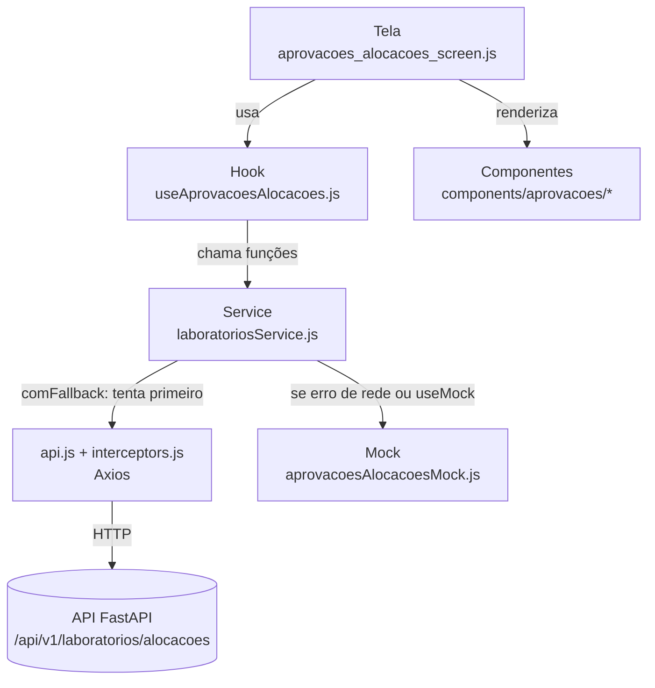

# Guia de estudo: RF-LAB05 (Aprovação de Alocações e Detecção de Conflitos)

> [!tip] Como usar este guia
> Leia as seções 1 a 7 com o código aberto do lado. Na seção 8, tente responder cada pergunta **em voz alta antes** de abrir a resposta (as respostas estão recolhidas).

> [!important] O professor pergunta fluxo, não linha de código
> Ele avisou que vai perguntar "como essa tela funciona? se eu apertar nesse botão, o que acontece? consegue me mostrar no código?". Para isso, o material certo é o [[RF-LAB05 (roteiro de perguntas)]]: cada botão com a fala, a sequência de arquivos e a linha para abrir.

---

## 1. Resumo em 30 segundos

O RF-LAB05 é a tela do **Administrador** que mostra a **fila de pedidos de uso de laboratório** feitos pelos professores. Para cada pedido ele pode **aprovar** ou **rejeitar**.

Duas regras de negócio:

- **RN04 (conflito de grade):** não pode aprovar duas aulas na mesma sala, mesmo dia e mesmo horário. O **servidor** detecta o conflito; a tela só mostra o alerta vermelho e trata o erro `409`.
- **RN05 (justificativa obrigatória):** para rejeitar, o admin precisa escrever o motivo (mínimo de 10 caracteres). A tela avisa, mas quem garante é o servidor, com erro `422`.

E um diferencial: se a API estiver fora do ar, o app usa um **mock** (dados locais) com o **mesmo contrato e as mesmas regras**, e mostra uma faixa avisando.

---

## 2. Contexto do projeto

- **Nome:** Portal de Serviços e Gestão IFAM.
- **Tecnologia:** React Native com **Expo** (roda em Android, iOS e navegador).
- **HTTP:** **Axios**.
- **Back-end:** API em **FastAPI** (Python), em outro repositório (`backend-ifam`). Os erros vêm no campo `detail`.
- **Trabalho coletivo:** várias equipes no mesmo repositório, cada uma com um requisito. Fluxo **GitFlow**: cada requisito numa branch `feature/...`, que entra na `develop` por pull request. O nosso foi o PR #27, `feature/RF-LAB05` → `develop`.
- **Situação:** só duas telas estão integradas à API de verdade, **RF-EQ01** (tipos de recurso) e **RF-LAB05** (a nossa). As outras são protótipos com dados fixos.

---

## 3. Arquitetura

### 3.1 Organização das pastas (feature-first)

O código é organizado **por funcionalidade (módulo)**, não por tipo de arquivo.

```
src/
├── core/                    ← compartilhado por todos os módulos
│   ├── services/
│   │   ├── api.js           ← instância do Axios (URL base, timeout)
│   │   └── interceptors.js  ← token JWT + normalização de erros
│   ├── theme/colors.js      ← Design System V2 (COLORS, RADIUS)
│   ├── components/ hooks/ context/ utils/
├── modules/
│   ├── equipamentos/        ← Módulo 1
│   ├── laboratorios/        ← Módulo 2 (o nosso)
│   │   ├── screens/aprovacoes_alocacoes_screen.js   ← TELA (orquestração, 136 linhas)
│   │   ├── hooks/useAprovacoesAlocacoes.js          ← HOOK (dados: carregar/aprovar/rejeitar)
│   │   ├── components/aprovacoes/                   ← COMPONENTES (9 + estilos + index.js)
│   │   ├── utils/                                   ← formatadores, filtros, busca, diálogos
│   │   ├── services/laboratoriosService.js          ← SERVICE
│   │   └── services/aprovacoesAlocacoesMock.js      ← MOCK
│   ├── hub/  auth/
└── navigation/              ← navegação (de outra equipe, não mexemos)
tests/laboratorios/run.cjs   ← 15 testes dos módulos puros
App.js                       ← escolhe qual tela abrir
app.json                     ← configuração (apiBaseUrl, useMock, telaInicial)
```

**Por que feature-first?** Tudo de um requisito fica junto. Uma equipe trabalha na sua pasta sem pisar na das outras, e fica fácil achar o código de um módulo.

> [!note] Desde 15/11/2026 a tela é componentizada
> A primeira entrega (PR #27) tinha a tela num arquivo só, de 908 linhas. Na etapa 3 ela foi dividida em tela + hook + componentes + utils, **sem mudar o que o usuário vê**. O passo a passo do código novo está em [[RF-LAB05 (código explicado)]]; as decisões, na seção 7 de `/docs/RF-LAB05_frontend_decisoes.md`.
>
> Em 16/11/2026 (etapa 4), depois de testar no celular: a barra de status do Android parou de cobrir o conteúdo, o visual ficou mais enxuto (cada informação aparece uma vez) e entrou a **busca por texto**. Decisões na seção 8 do mesmo arquivo.

### 3.2 Camadas



| Camada | Responsabilidade | NÃO faz |
|---|---|---|
| **Tela** | Ligar o hook aos componentes; guardar o que está aberto (modal); traduzir erro em diálogo | Não chama o service, não tem `StyleSheet` de card nem de modal |
| **Hook** | Carregar a fila, aprovar, rejeitar; estados de rede (carregando, erro, modo mock, card em processamento) | Não desenha nada, não abre diálogo |
| **Componentes** | Desenhar cabeçalho, chips, card, alerta de conflito, modal, estados da lista | Não importam o service; recebem props e disparam callbacks |
| **Utils** | Formatar data/agenda, montar o filtro da API, `avisar`/`confirmar` | Funções puras, sem React (exceto `Platform`/`Alert` nos diálogos) |
| **Service** | Saber quais endpoints chamar e decidir entre API e mock | Não desenha nada |
| **api.js / interceptors.js** | Configurar o Axios, colocar o token, traduzir erros | Não conhece regras de laboratório |
| **Mock** | Imitar a API (mesmos campos, mesmas regras, mesmos erros) | Não é usado diretamente pela tela |
| **Back-end** | **Decidir** as regras (RN04, RN05) e guardar os dados | |

> [!important] Frase-chave para a defesa
> "A tela cuida da **apresentação**; a **decisão** é do servidor. A tela nunca importa o mock nem o Axios diretamente, ela só conhece o service."
>
> E, dentro do front-end: "**o hook sabe de dados, os componentes sabem de desenho, a tela sabe o que está aberto.** Só o hook importa o service."

### 3.3 Como o app abre a nossa tela

Ainda não existe navegação global (é de outra equipe). Então:

- `App.js` tem um mapa `TELAS`:
  ```js
  const TELAS = {
    TIPOS_RECURSO: TiposRecursoScreen,          // RF-EQ01
    APROVACOES_ALOCACOES: AprovacoesAlocacoesScreen, // RF-LAB05
  };
  ```
- Ele lê `app.json` → `expo.extra.telaInicial` (hoje `"APROVACOES_ALOCACOES"`) e renderiza essa tela.
- Se a chave não existir, mostra uma mensagem listando as telas disponíveis.

**Por que fizemos assim?** Antes o `App.js` abria fixo a tela do RF-EQ01. Se trocássemos pela nossa, apagaríamos a demonstração da outra dupla. Com o mapa, cada dupla acrescenta **uma linha** e troca **uma palavra**. E as chaves já usam os nomes de rota previstos, então quando a navegação chegar, cada item vira um `<Stack.Screen>`.

### 3.4 Configuração (`app.json`)

```json
"extra": {
  "apiBaseUrl": "http://localhost:8000",
  "useMock": false,
  "telaInicial": "APROVACOES_ALOCACOES"
}
```

- `apiBaseUrl`: endereço da API. No celular físico, `localhost` é o próprio celular, então troca pelo IP do PC.
- `useMock`: se `true`, nem tenta a API, vai direto pro mock.
- Lido em `api.js` via `Constants.expoConfig.extra` (pacote `expo-constants`).

---

## 4. O código, arquivo por arquivo

### 4.1 `core/services/api.js`

- Cria **uma instância** do Axios com `baseURL`, `timeout: 10000` (10 s) e header JSON.
- Exporta `USE_MOCK` (vem do `app.json`).
- Todos os services usam essa mesma instância (configuração num lugar só).

### 4.2 `core/services/interceptors.js`

Interceptors são funções que o Axios roda **antes de toda requisição** e **depois de toda resposta**.

- **Request:** chama `obterTokenArmazenado()` e coloca `Authorization: Bearer <token>`. **Hoje devolve `null`**, porque o login (RF-CORE01) é de outra equipe. É um "ponto de troca": quando o login existir, muda só essa função.
- **Response (erro):** padroniza o erro do Axios, acrescentando:
  - `erro.mensagem` → texto legível, lido do `detail` do FastAPI (se for erro 422 do Pydantic, junta as mensagens da lista);
  - `erro.status` → código HTTP (`409`, `422`...) ou `null`;
  - `erro.codigoInterno = 'ERRO_DE_REDE'` → quando **não houve resposta** (API fora, timeout).
- `isErroDeRede(erro)` → diz se o erro foi de conexão.
- `registrarInterceptors()` é chamado no próprio arquivo, então os interceptors são registrados assim que o arquivo é importado (o service importa `isErroDeRede` dele).

> [!note] Por que isso importa
> A tela só olha `erro.status` e `erro.mensagem`. Ela não precisa saber o formato de erro do Axios nem do FastAPI.

### 4.3 `laboratorios/services/laboratoriosService.js` (o service)

**Estado do módulo:**
```js
let usandoMock = USE_MOCK;
export function isModoMock() { return usandoMock; }
```
`usandoMock` é uma variável "privada" do arquivo; quem está fora só lê pela função `isModoMock()`.

**O coração: `comFallback(chamadaApi, chamadaMock)`**
```js
async function comFallback(chamadaApi, chamadaMock) {
  if (usandoMock) return chamadaMock();      // já está no modo mock
  try {
    return await chamadaApi();               // tenta a API real
  } catch (erro) {
    if (isErroDeRede(erro)) {                // API fora do ar
      usandoMock = true;                     // liga o modo mock
      return chamadaMock();                  // repete no mock
    }
    throw erro;                              // erro de negócio: repassa pra tela
  }
}
```
Recebe **duas funções** (a da API e a do mock) e decide qual usar. Diferença importante:
- **erro de rede** → usa o mock;
- **erro de negócio** (404, 409, 422) → **não** usa o mock, repassa pra tela. A API respondeu, só disse "não".

**As 4 funções exportadas:**

| Função | Requisição real | Mock |
|---|---|---|
| `listarAlocacoesPendentes(filtros)` | `GET /alocacoes/pendentes` com `params: filtros` | `mock.listarPendentes` |
| `listarConflitosDaAlocacao(id)` | `GET /alocacoes/{id}/conflitos` | `mock.listarConflitos` |
| `aprovarAlocacao(id)` | `PATCH /alocacoes/{id}/status` com `{status_alocacao: 'Aprovada', justificativa_rejeicao: null}` | `mock.decidir` |
| `rejeitarAlocacao(id, justificativa)` | `PATCH /alocacoes/{id}/status` com `{status_alocacao: 'Rejeitada', justificativa_rejeicao}` | `mock.decidir` |

> [!warning] Saber responder
> `listarConflitosDaAlocacao` existe no service, mas **a tela não usa**, porque os conflitos já vêm junto em cada item da listagem (campo `conflitos`). Ficou disponível para uma tela de detalhe futura.

### 4.4 `laboratorios/services/aprovacoesAlocacoesMock.js` (o mock)

- `SEED`: 3 pedidos fixos, **com os mesmos UUIDs e campos** do seed do back-end:
  1. Lab 01 Redes, Prof. Roberto Dias, **Pontual**, sem conflito.
  2. Lab 02 Desenvolvimento, Profª. Camila Ribeiro, **Semestral**, sem conflito.
  3. Lab 03 Computação Gráfica, Prof. Marcos Lima (Blender), **Pontual**, **com conflito** (`conflito_detectado: true`) com "Introdução à Computação Gráfica" do Prof. Carlos Bento, que já está **Aprovada** e tem `bloqueia_aprovacao: true`.
- `let pendentes = SEED.map(item => ({ ...item }))` → a fila "viva", em memória. Começa como **cópia** do SEED.
- `LATENCIA_MS = 300` e `esperar()` → atraso artificial de 300 ms para parecer uma rede de verdade (o spinner aparece).
- `erroApi(status, detail)` → cria um `Error` com `mensagem` e `status`, **no mesmo formato** que o interceptor produz. Assim a tela trata o erro do mock igual ao da API.
- `listarPendentes({ tipo_alocacao })` → filtra pelo tipo e devolve **cópias** dos itens.
- `listarConflitos(id)` → devolve os conflitos ou erro `404`.
- `decidir(id, corpo)` → **aplica as regras**:
  - não achou → `404`;
  - aprovação com algum conflito `bloqueia_aprovacao` → `409` (RN04);
  - rejeição sem justificativa (vazia) → `422` (RN05);
  - sucesso → tira da fila e devolve `{ id_alocacao, status_alocacao, mensagem }`.
- `reiniciar()` → volta a fila ao estado do SEED (útil para testes e para repetir a demonstração).

### 4.5 A tela e suas partes (`screens/`, `hooks/`, `components/aprovacoes/`, `utils/`)

> Detalhe linha a linha em [[RF-LAB05 (código explicado)]]. Aqui, o suficiente para a defesa.

**A tela (`aprovacoes_alocacoes_screen.js`, 136 linhas)** é orquestração:

```
AprovacoesAlocacoesScreen
├── fila = useAprovacoesAlocacoes()   ← dados e ações
├── pedidoParaRejeitar (useState)     ← único estado da tela: qual modal está aberto
├── <CabecalhoAprovacoes>  <BannerModoOffline>  <CampoBusca>  <FiltrosTipoAlocacao>
├── renderConteudo(): <EstadoCarregando> | <EstadoErro> | <ListaPedidosAlocacao>
└── <ModalRejeicaoAlocacao pedido={pedidoParaRejeitar} ... />
```

- `handleAprovar(pedido)`: `confirmar(...)` → `await fila.aprovar(pedido)` → `avisar('✅ Aprovado')`; no `catch`, título "⚠️ Conflito de horário" se `erro.status === 409`.
- `handleConfirmarRejeicao(justificativa)`: `await fila.rejeitar(...)` → fecha o modal → `avisar('🚫 Rejeitado')`.
- A tela traduz **erro em diálogo**; o resto é delegado.
- No Android, o estilo do container soma `Constants.statusBarHeight` ao topo, porque o `SafeAreaView` do React Native só funciona no iOS.

**O hook (`useAprovacoesAlocacoes.js`)** guarda os dados e fala com o service:

| Devolve | Para quê |
|---|---|
| `pedidos`, `filtroTipo`, `carregando`, `atualizando`, `erroCarregamento`, `modoMock`, `idEmProcessamento` | os mesmos estados da versão antiga, agora fora da tela |
| `busca`, `pedidosVisiveis` | o texto digitado e a lista já filtrada por ele (`useMemo`), no aparelho |
| `setFiltroTipo` | trocar o chip; o hook refaz o `GET` com o filtro **no servidor** (`useCallback` + `useEffect`) |
| `setBusca` | digitar na busca; **não** faz requisição, só refiltra a lista |
| `recarregar()` / `atualizar()` | spinner grande / spinner do puxar pra baixo |
| `aprovar(pedido)` | chama o service, tira da fila, recarrega se 409, **devolve** `{ mensagem }` ou **relança** o erro |
| `rejeitar(pedido, justificativa)` | chama o service, tira da fila, devolve `{ mensagem }` |

Novidade: o hook numera cada `GET` (`useRef`) e **ignora respostas obsoletas**, resolvendo a condição de corrida de trocar os chips rápido.

**Os componentes (`components/aprovacoes/`)** só desenham; nenhum importa o service:

| Componente | Props | Desenha |
|---|---|---|
| `CabecalhoAprovacoes` | `totalPendentes`, `onVoltar` | uma linha: ‹, título e contador |
| `BannerModoOffline` | — | faixa amarela (a tela decide quando mostrar) |
| `CampoBusca` | `valor`, `onChange` | campo de busca com ✕ para limpar (controlado) |
| `FiltrosTipoAlocacao` | `valor`, `onChange` | chips Todos / Pontual / Semestral (controlado) |
| `ListaPedidosAlocacao` | `pedidos`, `atualizando`, `onAtualizar`, `idEmProcessamento`, `onAprovar`, `onRejeitar`, `filtroTipo`, `busca` | `FlatList` + pull-to-refresh + vazio |
| `CardPedidoAlocacao` | `pedido`, `processando`, `onAprovar`, `onRejeitar` | tipo, laboratório, quando, docente, disciplina, softwares, botões; usa `listarBloqueios` para marcar o Aprovar |
| `AlertaConflitoHorario` | `conflitos` | caixa vermelha da RN04, "Disciplina · Docente (status)" |
| `ModalRejeicaoAlocacao` | `pedido`, `onCancelar`, `onConfirmar` | modal da RN05; **dono** do texto digitado, do "enviando" e da validação dos 10 caracteres |
| `EstadoCarregando` / `EstadoErro` / `EstadoVazio` | `mensagem`, `onTentarNovamente`, `filtroTipo`, `busca` | os estados sem cards ("Nada encontrado" quando a busca não acha) |

**Os utils (`utils/`)**, funções puras com teste:
- `alocacaoFormatters.js`: `formatarData('2026-08-28')` → `'28/08/2026'`; `descreverAgenda(item)` → Semestral "Todas as Quartas-feiras (a partir de 05/08/2026)", Pontual "28/08/2026 • Sexta-feira"; `listarBloqueios`, `descreverConfirmacaoAprovacao`.
- `filtrosAlocacao.js`: a lista dos chips e `filtrosParaApi('Pontual')` → `{ tipo_alocacao: 'Pontual' }`.
- `buscaAlocacao.js`: `filtrarPorBusca(pedidos, 'camila web')` → só os pedidos que têm **todas** as palavras, sem ligar para acento ou maiúscula.
- `dialogos.js`: `avisar` / `confirmar` (`window.alert`/`confirm` na web, `Alert.alert` no celular).

**Estilos:** cada componente tem o próprio `StyleSheet.create` só com o que usa; cores e raios de `core/theme/colors.js` (Design System V2). O laranja "pendente" e a sombra do card, que se repetiam, ficaram em `estilosCompartilhados.js`.

**Testes:** `node tests/laboratorios/run.cjs` → 15 casos (formatadores, filtro da API, busca, regras RN04/RN05/404 do mock), sem dependência extra.

---

## 5. Fluxos completos

### 5.1 Abrir a tela (API no ar)
Tela monta → `useEffect` → `carregarPendentes` → service → `comFallback` → `api.get('/api/v1/laboratorios/alocacoes/pendentes')` → interceptor coloca token (nenhum por enquanto) → FastAPI responde a lista → `setPedidos` → cards na tela.

### 5.2 Abrir a tela (API fora)
... → `api.get` falha sem resposta → interceptor marca `ERRO_DE_REDE` → `comFallback` vê `isErroDeRede` → `usandoMock = true` → `mock.listarPendentes()` → 300 ms depois volta a lista → tela chama `isModoMock()` → `true` → aparece a faixa amarela.

### 5.3 Aprovar um pedido em conflito
Toque em Aprovar → confirmação → `aprovarAlocacao` → API (ou mock) responde **409** com o motivo → `comFallback` **repassa** (não é erro de rede) → tela mostra "⚠️ Conflito de horário" + motivo → recarrega a fila.

### 5.4 Rejeitar sem texto suficiente
Toque em Rejeitar → modal → "Confirmar Rejeição" com 3 caracteres → aviso "Justificativa obrigatória" → nada é enviado.

### 5.5 Buscar por texto
Digitar "camila" → `CampoBusca` chama `onChange` → `fila.setBusca` → o `useMemo` do hook recalcula `pedidosVisiveis` com `filtrarPorBusca` → a lista mostra só os pedidos da Profª. Camila. **Nenhuma requisição**; o contador do cabeçalho continua com o total da fila.

---

## 6. Dados mockados: resumo para a pergunta "como e onde?"

- **Onde está:** `src/modules/laboratorios/services/aprovacoesAlocacoesMock.js`.
- **Quem importa:** **só** o `laboratoriosService.js` (`import * as mock from './aprovacoesAlocacoesMock'`). A tela **nunca** importa o mock.
- **Onde é usado:** nas 4 funções do service, sempre como segundo argumento de `comFallback`.
- **Quando é ativado:**
  1. `useMock: true` no `app.json` (desde o início), ou
  2. a primeira requisição que falhar por **erro de rede**.
- **Como a tela sabe:** chama `isModoMock()` depois de cada operação e mostra a faixa amarela.
- **Como guarda os dados:** em memória, numa variável do módulo (`pendentes`). Some quando o app fecha. Aprovar ou rejeitar remove o item dessa variável.
- **Por que copia os objetos (`{ ...item }`):** para quem recebe a lista não alterar o original sem querer.
- **Por que aplica as regras:** um mock que aceita tudo demonstraria um sistema que não existe. Com as regras, a demonstração offline mostra exatamente o comportamento real.
- **Por que os mesmos UUIDs do back-end:** para o mock ser uma cópia fiel do contrato; trocar de um para o outro não muda nada na tela.
- **Origem do padrão:** o RF-EQ01 (`equipamentosService.js` + `tiposRecursoMock.js`) já fazia assim. Seguimos a convenção que já existia no repositório.

---

## 7. POO: como responder

> [!warning] Seja honesto
> O projeto **não usa classes**. Componentes React modernos são **funções** com hooks (`useState`, `useEffect`, `useCallback`). Não invente classes que não existem.

O que dá para mostrar são os **princípios** de orientação a objetos aplicados com módulos e funções:

| Conceito | Onde aparece no nosso código |
|---|---|
| **Encapsulamento** | `usandoMock` no service e `pendentes` no mock são variáveis do módulo, inacessíveis de fora. Só se lê `usandoMock` por `isModoMock()`; só se altera `pendentes` por `decidir()` e `reiniciar()`. |
| **Abstração** | A tela chama `aprovarAlocacao(id)` sem saber se existe Axios, URL, token ou mock por trás. |
| **"Interface" / contrato comum** | API real e mock têm o **mesmo contrato** (mesmos campos, mesmo formato de erro). São intercambiáveis, como duas classes que implementam a mesma interface. |
| **Polimorfismo (ideia)** | `comFallback` recebe duas funções diferentes e executa a que couber; quem chama não muda. Parecido com o padrão **Strategy**. |
| **Responsabilidade única (SOLID, S)** | Tela = apresentação; service = acesso a dados; interceptor = token e erros; mock = simulação. |
| **Inversão de dependência (ideia)** | A tela depende do **service** (uma abstração), não do Axios nem do mock (detalhes). |
| **Objetos** | A instância do Axios (`axios.create`) é um objeto com configuração; os erros são objetos `Error` enriquecidos com `mensagem` e `status`. |

Se o professor perguntar "por que não usou classe?": em React atual, componentes de função com hooks são o padrão recomendado; componentes de classe são considerados legado. E os princípios (encapsulamento, abstração, separação de responsabilidades) continuam aplicados, só que via módulos ES6.

---

## 8. Perguntas prováveis (tente responder antes de abrir)

### Arquitetura

> [!question]- Qual é a arquitetura do projeto?
> React Native com Expo, organização feature-first (`src/modules/<modulo>/{screens,services,components}` + `src/core` compartilhado). Camadas: tela → service → cliente HTTP (Axios + interceptors) → API FastAPI. O mock é uma alternativa à API, escolhida pelo service.

> [!question]- Por que separar tela e service?
> Responsabilidade única. A tela só apresenta. Se a URL mudar, ou se trocarmos API por mock, a tela não muda. Também facilita testar e reaproveitar.

> [!question]- Por que o conflito não é calculado no front-end?
> Porque a RN04 depende de **todas** as reservas do laboratório, e a tela só tem uma parte (filtrada, e no futuro paginada). Calcular nos dois lados criaria duas versões da mesma regra, e a do cliente ficaria desatualizada. O servidor decide; a tela apresenta.

> [!question]- Por que o filtro vai para a API em vez de filtrar a lista?
> Filtrar na memória só funciona se tudo estiver carregado. Com paginação, faltariam itens. O endpoint já aceita `tipo_alocacao`, então é o caminho que continua correto.

> [!question]- Como o App.js decide qual tela abrir?
> Mapa `TELAS` + `expo.extra.telaInicial` no `app.json`. Feito para não sobrescrever a tela de outra equipe; quando a navegação existir, cada entrada vira um `<Stack.Screen>`.

> [!question]- O que são os interceptors e o que fazem aqui?
> Funções que o Axios executa antes de cada requisição e depois de cada resposta. Aqui: colocar o token JWT (ainda `null`) e transformar qualquer erro em `mensagem`, `status` e, se for falta de conexão, `codigoInterno = 'ERRO_DE_REDE'`.

### Componentização

> [!question]- Como a tela está dividida? Por que não ficou num arquivo só?
> Tela (orquestração) + hook (dados) + componentes (desenho) + utils (funções puras). A primeira versão era um arquivo de 908 linhas; funcionava, mas para explicar "onde fica o card" era preciso rolar até a linha 226. Agora cada pergunta tem um arquivo: visual do card → `CardPedidoAlocacao.js`; o que acontece ao aprovar → `useAprovacoesAlocacoes.js`. É responsabilidade única aplicada dentro do front-end.

> [!question]- O que é um hook customizado e por que vocês fizeram um?
> Uma função `use...` que agrupa `useState`/`useEffect` e devolve dados e ações. Tiramos da tela tudo que fala com o service e os sete estados de rede. A tela ficou com um estado só (qual modal está aberto). O hook não abre diálogo e não desenha; por isso poderia ser reaproveitado numa tela de detalhe.

> [!question]- Os componentes chamam a API?
> Não. Nenhum componente importa o service. Eles recebem props (`pedido`, `processando`...) e disparam callbacks (`onAprovar`, `onRejeitar`). Quem chama o service é só o hook. Isso é o que permite trocar o visual sem risco de quebrar a regra, e vice-versa.

> [!question]- Por que os componentes estão em `components/aprovacoes/` e não direto em `components/`?
> A pasta `components/` do Módulo 2 já tem placeholders de outros requisitos (grade, ficha técnica...). A subpasta deixa claro o que é da Equipe 16 e evita colisão de nomes no merge. O `index.js` (barrel) faz a tela ter um import só para a camada visual.

> [!question]- Por que não usaram os componentes do `src/core/` (`ButtonIF`, `CardContainer`, `BadgeStatus`)?
> Porque ainda são `placeholder()` e pertencem à Equipe do Core (seq_09). Preencher esses arquivos geraria conflito com o trabalho dela. Os equivalentes nossos (`SOMBRA_CARD`, `formatarData`, `avisar`/`confirmar`) ficaram dentro do módulo; quando o core entregar, a troca é um import.

> [!question]- O modal valida a justificativa ou a tela?
> O modal. Ele guarda o texto digitado e o estado "enviando", faz o `trim()`, exige 10 caracteres e só então chama `onConfirmar(texto)`. A tela recebe a justificativa pronta. E a regra de verdade continua no servidor (422).

> [!question]- A refatoração mudou o comportamento?
> Quase nada, de propósito: corrigimos o plural da alocação semestral ("Quartas-feiras", "Sábados"), passamos a ignorar respostas obsoletas quando o filtro muda rápido (condição de corrida) e o ✕/Cancelar do modal ficam desabilitados durante o envio. O Aprovar em conflito continua clicável (decisão: quem decide é o servidor).

> [!question]- Como vocês garantiram que não quebrou?
> 15 testes automatizados dos módulos puros (`node tests/laboratorios/run.cjs`), bundle web gerado pelo Metro sem erro de import e transpilação de cada arquivo novo. A verificação visual no navegador é refeita com o roteiro de demonstração.

### Funcionamento

> [!question]- O que acontece quando o admin aprova um pedido em conflito?
> A tela pede confirmação e envia o PATCH. A API (ou o mock) responde 409. O `comFallback` repassa, porque é erro de negócio. A tela mostra "Conflito de horário" com o motivo e recarrega a fila.

> [!question]- Por que o botão de aprovar em conflito não fica desabilitado?
> Escolha de projeto: ele fica visualmente marcado ("🔒 Aprovar (em conflito)"), mas quem tem a palavra final é o servidor, que responde 409 explicando o motivo. Se a situação mudou no servidor (o outro pedido foi cancelado, por exemplo), a aprovação passa. *(Ponto a melhorar: poderia desabilitar de vez.)*

> [!question]- Como funciona a validação da justificativa (RN05)?
> Na tela: `trim()` e mínimo de 10 caracteres, com contador; se faltar, aparece um aviso e nada é enviado. É só conforto. A regra real é do servidor (422). Validação no cliente é feedback, não segurança.

> [!question]- O README diz que o modal "só habilita o envio" com 10 caracteres. É isso mesmo?
> Não exatamente: o botão fica clicável, mas ao tocar com menos de 10 caracteres aparece o aviso e nada é enviado. O efeito é o mesmo; o texto do README está impreciso.

> [!question]- Por que tem `avisar` e `confirmar` em vez de usar `Alert.alert` direto?
> `Alert.alert` do React Native não funciona bem na web. Os helpers usam `window.alert/confirm` no navegador e `Alert.alert` no celular.

> [!question]- Para que servem `useState`, `useEffect`, `useCallback` e `useRef` aqui?
> `useState` guarda os dados e estados (no hook; na tela só o modal aberto; no modal, o texto e o "enviando"). `useEffect` carrega a fila quando a tela abre e quando `carregar` muda, e limpa o campo do modal quando o pedido muda. `useCallback` recria `carregar` só quando `filtroTipo` muda; é isso que faz trocar o filtro refazer a busca. `useRef` guarda o número da última requisição sem redesenhar a tela, para descartar respostas obsoletas.

> [!question]- Depois de aprovar, por que não recarrega a lista inteira?
> Para ser rápido: `removerDaFila` tira só aquele item do estado. Recarrega a lista inteira apenas no caso de 409, porque aí a situação no servidor pode ter mudado.

> [!question]- O que é `idEmProcessamento`?
> O id do card que está sendo aprovado. Serve para mostrar o spinner no botão certo e desabilitar os botões daquele card, evitando clique duplo.

> [!question]- Como fica uma alocação semestral na tela?
> "Todas as Quartas-feiras (a partir de 05/08/2026)", porque `data_reserva` é o início do semestre e a aula se repete toda semana.

### Dados mockados

> [!question]- Onde ficam os dados mockados e quem os usa?
> Em `aprovacoesAlocacoesMock.js`. Só o `laboratoriosService.js` importa; a tela nunca acessa o mock diretamente.

> [!question]- Quando o mock entra em ação?
> Se `useMock: true` no `app.json`, ou quando uma requisição falha por erro de rede (sem resposta do servidor). A partir daí, `usandoMock` fica `true`.

> [!question]- Se a API responder 409, o app cai no mock?
> Não. Só erro de **rede** leva ao mock. 404, 409 e 422 são respostas da API e vão para a tela tratar.

> [!question]- Por que o mock também aplica as regras RN04 e RN05?
> Porque um mock que aceita tudo mostraria um comportamento que o sistema real não tem. A demonstração offline precisa ser fiel.

> [!question]- Como o usuário sabe que está vendo dados de mentira?
> A tela chama `isModoMock()` depois de cada operação e, se for `true`, mostra a faixa "Servidor indisponível, exibindo dados locais de demonstração".

> [!question]- Os dados do mock persistem?
> Não. Ficam numa variável em memória (`pendentes`) e voltam ao SEED quando o app recarrega ou quando `reiniciar()` é chamado.

> [!question]- Para que serve a latência de 300 ms?
> Simular uma rede real, para o spinner aparecer e a experiência ser parecida com a da API.

> [!question]- Por que `{ ...item }`?
> Para devolver cópias, e quem recebe não alterar a fila original do mock sem querer. (É uma cópia rasa: objetos aninhados, como `laboratorio`, ainda são compartilhados.)

### Limitações (mostra maturidade admitir)

> [!question]- Como vocês garantem que só o administrador aprova?
> Hoje não garantimos no front: o token JWT ainda é `null`, porque o login (RF-CORE01) é de outra equipe. O ponto de troca está pronto no interceptor. E a permissão precisa ser verificada no back-end de qualquer forma; esconder botão no front não é segurança.

> [!question]- Se a API cair e depois voltar, o app volta a usar a API?
> Não. O `usandoMock` fica `true` até o app ser reiniciado. Melhoria possível: tentar a API de novo no "puxar pra baixo" ou depois de um tempo.

> [!question]- A busca chama a API?
> Não. Ela filtra no aparelho a lista que já veio do servidor, porque a API ainda não tem `?busca=` e a fila de pendentes é curta. Ignora acentos e maiúsculas e exige todas as palavras digitadas. O chip de tipo, esse sim, vai para a API. Se a fila crescer, a busca passa para o servidor trocando só o hook.

> [!question]- Por que o conteúdo ficava embaixo da barra de status? Como resolveram?
> O `SafeAreaView` do React Native só reserva espaço no iOS. No Android somamos `Constants.statusBarHeight` (do `expo-constants`, já instalado) ao topo da tela. Não usamos o `react-native-safe-area-context` porque ele exige mexer no `App.js`, que é compartilhado; quando o React Navigation entrar, ele traz essa biblioteca.

> [!question]- Por que tiraram o badge "Aguardando Análise" do card?
> Porque tudo nesta fila é pendente; o badge não informava nada. Na mesma linha, cada informação passou a aparecer uma vez só: o card ficou com laboratório, quando, quem e o quê, e o alerta de conflito quando houver.

> [!question]- O botão voltar (‹) funciona?
> Ainda não. Recebe uma função vazia em `onBackToMenu`, porque a navegação é de outra equipe.

> [!question]- O que vocês melhorariam?
> Desabilitar de verdade o Aprovar em conflito; sair do modo mock quando a API voltar; usar `listarConflitosDaAlocacao` numa tela de detalhe (o hook já serve para ela); paginação na fila; testar o hook e os componentes com `react-test-renderer` (hoje só os módulos puros têm teste); migrar `dialogos.js`, `formatarData`, e a sombra para o `src/core/`; levar a busca para o servidor (`?busca=`) se a fila crescer quando a Equipe do Core preencher a pasta.

---

## 9. Roteiro de demonstração

1. Abrir: 3 pedidos; o do **Blender (Lab 03)** em vermelho, mostrando o conflito com o Prof. Carlos Bento.
2. **Aprovar** o do Blender → alerta de conflito (RN04).
3. **Rejeitar** com texto curto → aviso (RN05). Com texto válido → sai da fila.
4. **Aprovar** o de Redes (Lab 01) → "Alocação aprovada. Notificação disparada ao docente."
5. Trocar os chips → a lista muda (nova requisição).
6. Digitar o nome de um professor na busca → a lista filtra na hora, sem requisição.
7. Derrubar a API e puxar a lista → faixa amarela; os passos 2 a 4 continuam funcionando.

Comandos:
```bash
# back-end (repositório backend-ifam)
uvicorn app.main:app --reload --host 0.0.0.0 --port 8000
# app
npm install
npx expo start -c   # QR code no Expo Go (SDK 58); 'w' abre no navegador
```

---

## 10. Glossário rápido

- **Expo:** ferramenta que facilita rodar React Native (Expo Go, web, build).
- **Axios:** biblioteca de requisições HTTP.
- **Endpoint:** endereço da API para uma operação (`GET /alocacoes/pendentes`).
- **GET / PATCH:** buscar dados / atualizar parte de um recurso.
- **200 / 404 / 409 / 422:** ok / não encontrado / conflito / dados inválidos.
- **Mock:** implementação falsa que imita a real.
- **Fallback:** plano B quando o plano A falha.
- **Contrato:** formato combinado dos dados (campos, tipos, erros) entre front e back.
- **Seed:** dados iniciais de exemplo.
- **JWT:** token que identifica o usuário logado.
- **Feature-first:** pastas organizadas por funcionalidade.
- **GitFlow:** `main`, `develop` e branches `feature/...` integradas por pull request.
- **Conventional Commits:** padrão de mensagem (`feat(laboratorios): ...`, `docs: ...`).