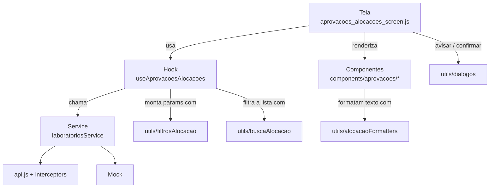

# RF-LAB05: o código explicado

> [!info] Relação com o outro guia
> O [[Projeto Desenvolvimento Mobile (Benevaldo)]] explica a **arquitetura** e as **perguntas da defesa**. Esta nota desce um nível: explica **o que cada pedaço do código faz e por que está escrito daquele jeito**. Leia com os arquivos abertos do lado. O mesmo para o back-end (FastAPI) está em [[RF-LAB05 backend (código explicado)]].

> [!important] Versão desta nota
> Em 15/11/2026 a tela foi **componentizada**: o arquivo único de 908 linhas virou uma tela de 123 linhas + um hook + oito componentes + três utilitários. Esta nota descreve a versão nova (branch `feature/RF-LAB05`, etapa 3). A versão antiga (commit `ed436e9` da `develop`) continua no histórico do Git; as decisões da mudança estão em `/docs/RF-LAB05_frontend_decisoes.md`, seção 7.
>
> Em 16/11/2026 (etapa 4) entraram três mudanças: a barra de status do Android deixou de cobrir o conteúdo, o visual ficou mais enxuto e entrou a **busca por texto** (`CampoBusca` + `utils/buscaAlocacao.js`). Decisões na seção 8 do mesmo arquivo. Para a defesa, use também o [[RF-LAB05 (roteiro de perguntas)]].

Arquivos cobertos, na ordem em que aparecem aqui (todos em `src/modules/laboratorios/`, salvo o cliente HTTP):

1. `screens/aprovacoes_alocacoes_screen.js` (a tela: orquestração)
2. `hooks/useAprovacoesAlocacoes.js` (os dados)
3. `components/aprovacoes/*` (o desenho)
4. `utils/*` (formatadores, filtros, busca, diálogos)
5. `services/laboratoriosService.js` (o service)
6. `services/aprovacoesAlocacoesMock.js` (o mock)
7. `src/core/services/api.js` e `interceptors.js` (o cliente HTTP)
8. `tests/laboratorios/run.cjs` (os testes)

---

## Parte 0. O mapa antes de mergulhar

```
screens/aprovacoes_alocacoes_screen.js      136 linhas   "o que está aberto" + diálogos
hooks/useAprovacoesAlocacoes.js             144 linhas   "de onde vêm os dados e o que acontece ao aprovar"
components/aprovacoes/
  CabecalhoAprovacoes.js                     67          voltar, título e contador em uma linha
  BannerModoOffline.js                       31          faixa amarela discreta
  CampoBusca.js                              68          busca por texto (novo, 16/11)
  FiltrosTipoAlocacao.js                     65          chips Todos / Pontual / Semestral
  ListaPedidosAlocacao.js                    58          FlatList + puxar pra baixo
  CardPedidoAlocacao.js                     181          o card
  AlertaConflitoHorario.js                   46          caixa vermelha (RN04)
  ModalRejeicaoAlocacao.js                  207          modal (RN05)
  EstadosDaLista.js                         108          carregando / erro / vazio / nada encontrado
  estilosCompartilhados.js                   25          laranja "pendente" + sombra
  index.js                                   16          barrel (reexporta tudo)
utils/alocacaoFormatters.js                  56          datas, agenda, confirmação, bloqueios
utils/filtrosAlocacao.js                     24          chips → params da API
utils/buscaAlocacao.js                       46          busca no aparelho (novo, 16/11)
utils/dialogos.js                            38          avisar / confirmar
services/laboratoriosService.js             123          API com fallback (não mudou)
services/aprovacoesAlocacoesMock.js         188          mock (não mudou)
```

> [!tip] A regra de separação, em uma frase
> **Hook** = dados (é o único que importa o service). **Componentes** = desenho (recebem props, disparam callbacks, não importam o service). **Tela** = o que está aberto agora + traduzir erro em diálogo. **Utils** = funções puras, sem React.



---

## Parte 1. A tela (`aprovacoes_alocacoes_screen.js`)

### 1.1 Imports

```js
import { useState } from 'react';
import Constants from 'expo-constants';
import { Platform, SafeAreaView, StatusBar, StyleSheet } from 'react-native';
import { COLORS } from '../../../core/theme/colors';
import { BannerModoOffline, CabecalhoAprovacoes, CampoBusca, EstadoCarregando, EstadoErro,
  FiltrosTipoAlocacao, ListaPedidosAlocacao, ModalRejeicaoAlocacao } from '../components/aprovacoes';
import { useAprovacoesAlocacoes } from '../hooks/useAprovacoesAlocacoes';
import { descreverConfirmacaoAprovacao } from '../utils/alocacaoFormatters';
import { avisar, confirmar } from '../utils/dialogos';
```

- Só **um** hook do React (`useState`) e poucas coisas do React Native. `Constants` e `Platform` entraram em 16/11 só para a barra de status do Android (ver 1.6). Antes eram 13 imports do React Native; agora `FlatList`, `Modal`, `TextInput`, `Alert`... moram nos componentes que os usam.
- `'../components/aprovacoes'` sem nome de arquivo: o Node/Metro procura `index.js` dentro da pasta. É o **barrel**: um arquivo que só reexporta os outros, para a tela ter um import só para a camada visual.
- Repare no que a tela **não** importa: nem o service, nem o Axios, nem o mock. Ela nem sabe que existe API.

### 1.2 O hook e o único estado da tela

```js
const fila = useAprovacoesAlocacoes();
const [pedidoParaRejeitar, setPedidoParaRejeitar] = useState(null);
```

- `fila` é um objeto com tudo que vem do hook: `pedidos`, `pedidosVisiveis`, `filtroTipo`, `busca`, `carregando`, `atualizando`, `erroCarregamento`, `modoMock`, `idEmProcessamento` (dados) e `setFiltroTipo`, `setBusca`, `recarregar`, `atualizar`, `aprovar`, `rejeitar` (ações). Na tela aparece sempre como `fila.alguma_coisa`, o que ajuda a enxergar o que é "da fila" e o que é "da tela".
- `pedidoParaRejeitar` é o **único `useState` da tela**: qual pedido está com o modal aberto. `null` = modal fechado. Antes a tela tinha 11 estados; os outros 10 foram para o hook (dados) ou para o modal (texto digitado e "enviando").

> [!question]- Por que esse estado ficou na tela e não no hook?
> Porque "qual modal está aberto" é interface, não dado. Se o hook fosse reaproveitado numa tela de detalhe, essa tela poderia nem ter modal. A regra: o hook só guarda o que vem do servidor ou descreve a comunicação com ele.

### 1.3 Aprovar: `handleAprovar`

```js
const handleAprovar = (pedido) => {
  confirmar('Confirmar Aprovação', descreverConfirmacaoAprovacao(pedido), async () => {
    try {
      const { mensagem } = await fila.aprovar(pedido);
      avisar('✅ Aprovado', mensagem);
    } catch (erro) {
      avisar(erro.status === 409 ? '⚠️ Conflito de horário' : 'Não foi possível aprovar',
             erro.mensagem ?? 'Tente novamente.');
    }
  }, 'Aprovar');
};
```

- `confirmar` recebe o **callback** como terceiro argumento; ele só roda se o admin aceitar. O callback é `async` porque espera o hook.
- `fila.aprovar(pedido)` faz o trabalho de dados (chama o service, tira da fila, recarrega se 409) e **devolve** `{ mensagem }` ou **lança** o erro. A tela só decide o título do aviso. Essa divisão é a decisão 13 do registro: hook devolve resultado e relança erro; quem avisa é a tela.
- `const { mensagem } = await ...` é desestruturação do resultado da API (`{ id_alocacao, status_alocacao, mensagem }`).
- Repare que **não há `finally`** aqui: o `setIdEmProcessamento(null)` está no `finally` do hook. A tela não precisa saber que isso existe.

### 1.4 Rejeitar: `handleConfirmarRejeicao`

```js
const handleConfirmarRejeicao = async (justificativa) => {
  try {
    const { mensagem } = await fila.rejeitar(pedidoParaRejeitar, justificativa);
    setPedidoParaRejeitar(null);          // fecha o modal
    avisar('🚫 Rejeitado', mensagem);
  } catch (erro) {
    avisar('Não foi possível rejeitar', erro.mensagem ?? 'Tente novamente.');
  }
};
```

- Quem chama é o **modal**, já com a `justificativa` validada (mínimo de 10 caracteres, `trim()` feito). A tela não vê o campo de texto.
- Ordem no sucesso: fecha o modal (`null`) **antes** de avisar, para o alerta não aparecer com o modal ainda aberto.
- Se der erro, o modal continua aberto com o texto, e o admin pode corrigir.

### 1.5 `renderConteudo` e o `return`

```js
const renderConteudo = () => {
  if (fila.carregando) return <EstadoCarregando />;
  if (fila.erroCarregamento) return <EstadoErro mensagem={fila.erroCarregamento} onTentarNovamente={fila.recarregar} />;
  return <ListaPedidosAlocacao pedidos={fila.pedidosVisiveis} filtroTipo={fila.filtroTipo}
           busca={fila.busca} atualizando={fila.atualizando} onAtualizar={fila.atualizar}
           idEmProcessamento={fila.idEmProcessamento}
           onAprovar={handleAprovar} onRejeitar={setPedidoParaRejeitar} />;
};
```

- Mesmos três estados de antes (carregando → erro → lista), com retornos antecipados, mas cada um é **um componente**.
- `onRejeitar={setPedidoParaRejeitar}`: o card chama `onRejeitar(pedido)`, e isso é exatamente `setPedidoParaRejeitar(pedido)`, que abre o modal. Não precisa de função intermediária.

```
SafeAreaView
├── StatusBar
├── <CabecalhoAprovacoes totalPendentes={fila.pedidos.length} onVoltar={onBackToMenu} />
├── {fila.modoMock && <BannerModoOffline />}
├── <CampoBusca valor={fila.busca} onChange={fila.setBusca} />
├── <FiltrosTipoAlocacao valor={fila.filtroTipo} onChange={fila.setFiltroTipo} />
├── {renderConteudo()}
└── <ModalRejeicaoAlocacao pedido={pedidoParaRejeitar}
      onCancelar={() => setPedidoParaRejeitar(null)} onConfirmar={handleConfirmarRejeicao} />
```

- A tela lê como um sumário. Cada linha é um componente com props claras; para saber **como** o cabeçalho é desenhado, abre-se `CabecalhoAprovacoes.js`.
- `onChange={fila.setFiltroTipo}`: trocar o chip muda o `filtroTipo` **dentro do hook**, e o hook refaz o GET sozinho (ver 2.2).
- `onChange={fila.setBusca}`: digitar na busca **não** faz GET. O hook refiltra a lista que já tem (ver 2.6).
- Repare: o cabeçalho conta `fila.pedidos` (a fila inteira) e a lista mostra `fila.pedidosVisiveis` (depois da busca). Se o contador caísse ao digitar, pareceria que a fila diminuiu.

### 1.6 A barra de status do Android (16/11)

```js
container: {
  flex: 1,
  backgroundColor: COLORS.neutralFundo,
  paddingTop: Platform.OS === 'android' ? Constants.statusBarHeight : 0,
},
```

- O `SafeAreaView` do React Native **só funciona no iOS**. No Android o conteúdo nascia embaixo do relógio e da bateria.
- `Constants.statusBarHeight` (do `expo-constants`, que já estava instalado) diz a altura da barra. Usar como `paddingTop` resolve sem biblioteca nova.
- A solução "completa" seria o `react-native-safe-area-context`, mas ele exige um `SafeAreaProvider` no `App.js`, que é compartilhado entre as equipes. Quando o React Navigation entrar, ele já traz essa biblioteca, e este `paddingTop` sai.

---

## Parte 2. O hook (`useAprovacoesAlocacoes.js`)

### 2.1 O que é um hook customizado

Uma função cujo nome começa com `use` e que **usa outros hooks** (`useState`, `useEffect`...). Serve para tirar lógica de dentro de um componente e dar um nome a ela. Quem chama recebe o que a função devolver; o React trata os estados dela como se estivessem no componente que a chamou.

### 2.2 Estados e carregamento

```js
const [pedidos, setPedidos] = useState([]);
const [filtroTipo, setFiltroTipo] = useState(FILTRO_TODOS);
const [busca, setBusca] = useState('');
const pedidosVisiveis = useMemo(() => filtrarPorBusca(pedidos, busca), [pedidos, busca]);
const [carregando, setCarregando] = useState(true);
const [atualizando, setAtualizando] = useState(false);
const [erroCarregamento, setErroCarregamento] = useState(null);
const [modoMock, setModoMock] = useState(false);
const [idEmProcessamento, setIdEmProcessamento] = useState(null);
const ultimaRequisicao = useRef(0);
```

| Estado | Para quê |
|---|---|
| `pedidos` | a lista exibida |
| `filtroTipo` | chip selecionado (`'Todos'`, `'Pontual'`, `'Semestral'`) |
| `carregando` | spinner grande (primeira carga e "Tentar novamente"); começa `true` para não piscar "Tudo em dia!" |
| `atualizando` | spinner do puxar pra baixo |
| `erroCarregamento` | mensagem da tela de erro |
| `modoMock` | se a faixa amarela aparece |
| `idEmProcessamento` | id do card que está aprovando (spinner só nele) |
| `ultimaRequisicao` | **não é estado**: é um `useRef`, um contador que não redesenha nada (ver 2.3) |

```js
const carregar = useCallback(async ({ silencioso = false } = {}) => {
  const numero = ++ultimaRequisicao.current;
  const aindaEhAtual = () => numero === ultimaRequisicao.current;
  if (silencioso) setAtualizando(true); else setCarregando(true);
  setErroCarregamento(null);
  try {
    const dados = await listarAlocacoesPendentes(filtrosParaApi(filtroTipo));
    if (!aindaEhAtual()) return;
    setPedidos(dados);
    sincronizarModoMock();
  } catch (erro) {
    if (!aindaEhAtual()) return;
    setErroCarregamento(erro.mensagem ?? 'Não foi possível carregar a fila de aprovações.');
  } finally {
    if (aindaEhAtual()) { setCarregando(false); setAtualizando(false); }
  }
}, [filtroTipo]);

useEffect(() => { carregar(); }, [carregar]);
```

- A corrente do filtro é a mesma de antes: toque no chip → `setFiltroTipo` → `useCallback` vê `filtroTipo` diferente e cria uma nova `carregar` → `useEffect` vê `carregar` diferente → executa → `GET` com o novo filtro.
- `filtrosParaApi(filtroTipo)` (em `utils/filtrosAlocacao.js`) devolve `{}` para "Todos" ou `{ tipo_alocacao: 'Pontual' }`. Antes era um ternário dentro da tela; agora é uma função com nome e teste.
- `sincronizarModoMock()` é só `setModoMock(isModoMock())`, chamado depois de cada operação.

### 2.3 A condição de corrida (novo)

Problema que existia na tela antiga: tocar em *Pontual* e logo em *Semestral* dispara dois GETs. Se o primeiro demorar mais, a resposta de *Pontual* chega **depois** e sobrescreve a lista de *Semestral*. A tela mostraria o filtro errado.

Solução: cada chamada pega um número (`++ultimaRequisicao.current`). Quando a resposta chega, `aindaEhAtual()` compara o número dela com o último disparado. Se outra requisição saiu no meio tempo, a resposta velha é **ignorada** (os `return` dentro do `try`/`catch`, e o `if` no `finally`).

> [!question]- Por que `useRef` e não `useState` para o contador?
> `useState` redesenha a tela a cada mudança, e o contador muda a cada requisição sem que nada visual dependa dele. `useRef` guarda um valor que **persiste entre renderizações** sem causar renderização. `ultimaRequisicao.current` é o valor; o `.current` é a convenção do `useRef`.

### 2.4 Aprovar e rejeitar

```js
const aprovar = async (pedido) => {
  setIdEmProcessamento(pedido.id_alocacao);
  try {
    const resultado = await aprovarAlocacao(pedido.id_alocacao);
    removerDaFila(pedido.id_alocacao);
    sincronizarModoMock();
    return resultado;
  } catch (erro) {
    if (erro.status === 409) carregar({ silencioso: true });
    throw erro;
  } finally {
    setIdEmProcessamento(null);
  }
};

const rejeitar = async (pedido, justificativa) => {
  const resultado = await rejeitarAlocacao(pedido.id_alocacao, justificativa);
  removerDaFila(pedido.id_alocacao);
  sincronizarModoMock();
  return resultado;
};
```

- `return resultado` / `throw erro`: o hook **não abre diálogo**. Quem chamou (a tela) recebe o resultado ou o erro e decide o que mostrar.
- Em 409 o hook recarrega a fila em silêncio (a situação mudou no servidor) **e depois** relança: a tela mostra o aviso enquanto a lista se atualiza.
- `rejeitar` não mexe em `idEmProcessamento` porque o spinner da rejeição fica no botão do modal, que controla o próprio "enviando".
- `removerDaFila` usa o setter funcional: `setPedidos((lista) => lista.filter(...))`, para trabalhar com a lista **mais atual**, não com a capturada antes do `await`.

### 2.5 O que o hook devolve

```js
return {
  pedidos, pedidosVisiveis, filtroTipo, busca,
  carregando, atualizando, erroCarregamento, modoMock, idEmProcessamento,
  setFiltroTipo, setBusca,
  recarregar: () => carregar(),
  atualizar: () => carregar({ silencioso: true }),
  aprovar, rejeitar,
};
```

`recarregar` e `atualizar` são as duas formas de chamar `carregar`, já com nome: o botão "Tentar novamente" usa a primeira (spinner grande), o puxar pra baixo usa a segunda (spinner pequeno). A tela não precisa saber da opção `silencioso`.

### 2.6 A busca por texto (16/11)

```js
const [busca, setBusca] = useState('');
const pedidosVisiveis = useMemo(() => filtrarPorBusca(pedidos, busca), [pedidos, busca]);
```

- **Dois filtros, dois lugares.** O chip vai para a API (`?tipo_alocacao=`). A busca é aplicada **no aparelho**, sobre a lista já carregada, porque a API ainda não tem `?busca=` e a fila de pendentes é curta.
- `useMemo` guarda o resultado e só recalcula quando `pedidos` ou `busca` mudam. Sem ele, a lista seria refiltrada em todo re-render (por exemplo, quando o spinner de um card liga).
- Aprovar ou rejeitar tira o pedido de `pedidos`; como `pedidosVisiveis` depende de `pedidos`, a lista filtrada atualiza sozinha.
- Quando o back-end ganhar `?busca=`: a busca vira mais um item de `filtrosParaApi`, entra nas dependências do `carregar` e o `useMemo` sai. Nada muda nos componentes.

---

## Parte 3. Os componentes (`components/aprovacoes/`)

Todos seguem o mesmo molde, que é o mesmo das outras equipes no repositório (`hub/components/ModuleCard.js`):

```js
import { ... } from 'react-native';
import { COLORS, RADIUS } from '../../../../core/theme/colors';

export function NomeDoComponente({ prop1, prop2 }) {   // export nomeado
  return ( ... );
}

const styles = StyleSheet.create({ ... });            // só os estilos que ele usa
```

> [!note] `../../../../` (quatro)
> Os componentes estão um nível mais fundo que a tela (`components/aprovacoes/`), por isso sobem quatro pastas até `src/`.

### 3.1 `CabecalhoAprovacoes({ totalPendentes, onVoltar })`

Uma linha só: `‹` (chama `onVoltar`, que é o `onBackToMenu` da tela), o título "Aprovações de Laboratório" e um badge amarelo com o número. O número vem pronto (`fila.pedidos.length`); o componente não conta nada. Em 16/11 saíram o subtítulo e o texto "Menu de Laboratórios", que repetiam o que o título já dizia.

### 3.2 `BannerModoOffline()`

Sem props. A faixa amarela "Sem conexão com o servidor · dados de demonstração", mais baixa e centralizada desde 16/11. Quem decide se ela aparece é a tela (`{fila.modoMock && <BannerModoOffline />}`), não o componente. Padrão: o componente não sabe **quando** aparecer, só **como**.

### 3.3 `FiltrosTipoAlocacao({ valor, onChange })`

```js
{FILTROS_TIPO_ALOCACAO.map((filtro) => {
  const ativo = filtro.valor === valor;
  return (
    <TouchableOpacity key={filtro.valor} style={[styles.chip, ativo && styles.chipAtivo]}
      onPress={() => onChange(filtro.valor)}
      accessibilityRole="button" accessibilityState={{ selected: ativo }}>
      <Text style={[styles.chipTexto, ativo && styles.chipTextoAtivo]}>{filtro.rotulo}</Text>
    </TouchableOpacity>
  );
})}
```

- **Componente controlado**: não guarda qual chip está ativo; recebe `valor` e avisa `onChange`. O dono do valor é o hook.
- A lista `FILTROS_TIPO_ALOCACAO` vem de `utils/filtrosAlocacao.js`, o mesmo arquivo que o hook usa para montar os params. Um lugar só para "quais filtros existem".
- `accessibilityRole` / `accessibilityState`: leitores de tela anunciam "botão, selecionado". Custa duas linhas.

### 3.3b `CampoBusca({ valor, onChange })` (16/11)

Componente controlado, igual aos chips: um `TextInput` com 🔍, `value={valor}` e `onChangeText={onChange}`. Quando há texto, aparece um ✕ que chama `onChange('')`. Não filtra nada; quem filtra é o hook. `autoCorrect={false}` e `autoCapitalize="none"` para o teclado não "corrigir" nomes de professores.

### 3.4 `ListaPedidosAlocacao({ pedidos, filtroTipo, busca, atualizando, onAtualizar, idEmProcessamento, onAprovar, onRejeitar })`

A `FlatList` com `RefreshControl` e `ListEmptyComponent`. Recebe `busca` só para repassar ao `EstadoVazio` (a frase muda quando a busca não acha nada). `keyboardShouldPersistTaps="handled"` deixa tocar num botão do card com o teclado da busca aberto. O `renderItem` monta um `<CardPedidoAlocacao>` por pedido, calculando `processando={idEmProcessamento === item.id_alocacao}` (só o card certo mostra spinner). Sete props parece muito, mas cada uma é um fio direto entre o hook e o card; a lista não inventa nada.

### 3.5 `CardPedidoAlocacao({ pedido, processando, onAprovar, onRejeitar })`

O maior componente (181 linhas, metade estilos). Desde 16/11, a ordem segue a importância da informação:

1. Linha de topo: o tipo (`Pontual` / `Semestral`) como rótulo azul pequeno à esquerda e o bloco à direita.
2. Nome do laboratório, em negrito.
3. Quando: `descreverAgenda(pedido) · descricao_tempo`.
4. Quem: nome do docente em destaque; embaixo, "disciplina · turma · N alunos".
5. "Softwares: A, B, C" numa linha (`join(', ')`, no máximo duas linhas).
6. `{pedido.conflito_detectado && <AlertaConflitoHorario conflitos={pedido.conflitos} />}`, logo antes dos botões.
7. Botões Rejeitar (contorno vermelho) / Aprovar (verde), os dois `disabled={processando}`.

```js
const aprovacaoBloqueada = listarBloqueios(pedido).length > 0;
```
`listarBloqueios` (em `utils/alocacaoFormatters.js`) filtra os conflitos com `bloqueia_aprovacao`. Função pura, testada.

> [!note] O que saiu do card em 16/11, e por quê
> - Badge "● Aguardando Análise": tudo nesta fila é pendente, então não informava nada.
> - Rótulos com emoji ("👤 Docente:", "📚 Disciplina:"...) e os componentes internos `Badge` e `LinhaInfo`: a posição e o peso da fonte já dizem o que é cada linha.
> - Chips de software: viraram uma linha de texto.
> - Aviso "A RN04 impede aprovar..." embaixo dos botões: o alerta vermelho já explica.

> [!warning] Ponto honesto (continua igual)
> O botão Aprovar em conflito **não** tem `disabled={aprovacaoBloqueada}`. Só muda de cor e texto. Ao tocar, o servidor responde 409. É decisão de projeto ("quem decide é o servidor"); foi mantida de propósito na refatoração.

### 3.6 `AlertaConflitoHorario({ conflitos })`

A caixa vermelha. Título "Conflito de horário neste laboratório" e um `<Text>` por conflito no formato "Disciplina · Docente (status)". O status em minúsculas diferencia quem bloqueia ("aprovada", "em_uso") de quem só disputa a vaga ("pendente"). `conflitos = []` como valor padrão protege contra `undefined`.

### 3.7 `ModalRejeicaoAlocacao({ pedido, onCancelar, onConfirmar })`

O componente que mais ganhou com a refatoração: ele é **dono do próprio estado**.

```js
const [justificativa, setJustificativa] = useState('');
const [enviando, setEnviando] = useState(false);

useEffect(() => { setJustificativa(''); }, [pedido]);   // limpa o campo a cada pedido novo

const confirmar = async () => {
  const texto = justificativa.trim();
  if (texto.length < MIN_JUSTIFICATIVA) { avisar('Justificativa obrigatória', ...); return; }
  setEnviando(true);
  try { await onConfirmar(texto); } finally { setEnviando(false); }
};
```

- `visible={pedido != null}`: aberto quando tem pedido, fechado quando `null`. Não existe mais `modalRejeicaoVisible`; o próprio `pedido` diz.
- `useEffect(..., [pedido])`: roda toda vez que `pedido` muda; limpa o texto para não mostrar a justificativa do pedido anterior.
- `onConfirmar(texto)` é a `handleConfirmarRejeicao` da tela. O modal espera (`await`) e desliga o spinner no `finally`, deu certo ou não. Se deu certo, a tela já pôs `pedido = null` e o modal fecha; se deu erro, continua aberto.
- `MIN_JUSTIFICATIVA = 10` é exportado daqui (e pelo barrel) porque é o modal quem valida.
- ✕ e Cancelar têm `disabled={enviando}`: não dá para fechar com a requisição em curso (pequena melhoria em relação à versão antiga).
- `pedido?.docente?.nome` continua precisando do `?.`: o JSX do modal é montado mesmo fechado, com `pedido = null`.

### 3.8 `EstadosDaLista.js`: `EstadoCarregando`, `EstadoErro`, `EstadoVazio`

Três componentes pequenos num arquivo só, porque dividem o mesmo layout centralizado e nunca aparecem juntos. `EstadoErro` recebe `mensagem` e `onTentarNovamente`; `EstadoVazio` recebe `filtroTipo` e `busca`: se há texto na busca, mostra "Nada encontrado — nenhum pedido corresponde a ..."; senão, "Tudo em dia! Não há solicitações pendentes do tipo Pontual.".

### 3.9 `estilosCompartilhados.js` e `index.js`

- `COR_TEXTO_PENDENTE = '#E65100'`: o laranja do protótipo, que não existe em `COLORS`. Antes estava escrito três vezes na tela; agora, uma. `SOMBRA_CARD`: o `Platform.select` do seq_03 (sombra no iOS, `elevation` no Android).
- `index.js`: só `export { X } from './X'`. É o que permite `import { ... } from '../components/aprovacoes'`.

---

## Parte 4. Os utilitários (`utils/`)

Funções **puras**: entrada → saída, sem estado, sem React. Por isso são as mais fáceis de testar.

### 4.1 `alocacaoFormatters.js`

| Função | Entrada | Saída |
|---|---|---|
| `formatarData('2026-08-28')` | DATE do banco | `'28/08/2026'` (fatiando o texto, sem `new Date`, para não cair no fuso de Manaus) |
| `descreverRecorrenciaSemanal('Quarta-feira')` | dia da semana | `'Todas as Quartas-feiras'`; `'Sábado'` → `'Todos os Sábados'` |
| `descreverAgenda(item)` | o pedido | Semestral → recorrência + "(a partir de dd/mm/aaaa)"; Pontual → "dd/mm/aaaa • Dia" |
| `descreverConfirmacaoAprovacao(pedido)` | o pedido | a frase da caixa de confirmação |
| `listarBloqueios(pedido)` | o pedido | só os conflitos com `bloqueia_aprovacao` |

> [!note] O plural foi corrigido
> A versão antiga só acrescentava um `s` ("Quarta-feiras"). `descreverRecorrenciaSemanal` troca `-feira` por `s-feiras` (os dois termos do composto vão para o plural) e usa "Todos os" para Sábado/Domingo (gênero masculino).

### 4.2 `filtrosAlocacao.js`

`FILTRO_TODOS = 'Todos'`, a lista `FILTROS_TIPO_ALOCACAO` (valor + rótulo) e `filtrosParaApi(filtroTipo)`. Hook e chips importam daqui: um lugar só para "quais filtros existem e como viram query string".

### 4.2b `buscaAlocacao.js` (16/11)

| Função | O que faz |
|---|---|
| `normalizarTexto('Profª. CAMILA')` | `'profa. camila'`: `normalize('NFKD')` separa letra e acento, a regex tira os acentos, depois minúsculas. O `NFKD` (e não só `NFD`) também desmonta `ª` e `º` |
| `textoPesquisavel(pedido)` | junta laboratório, bloco, docente, disciplina, turma e softwares num texto só, normalizado |
| `filtrarPorBusca(pedidos, busca)` | quebra a busca em palavras; o pedido passa se **todas** as palavras aparecem no texto dele. Busca vazia devolve a lista original |

"camila web" acha a Profª. Camila (docente) em Desenvolvimento Web (disciplina): cada palavra pode estar num campo diferente.

### 4.3 `dialogos.js`

`avisar(titulo, mensagem)` e `confirmar(titulo, mensagem, onConfirmar, textoConfirmar)`. Iguais aos helpers antigos: `window.alert` / `window.confirm` na web, `Alert.alert` no celular. Saíram da tela porque o modal também usa `avisar`. Candidatos a `src/core/utils/` quando a Equipe do Core preencher a pasta.

---

## Parte 5. O service (`laboratoriosService.js`) — não mudou

### 5.1 Estado do módulo
```js
let usandoMock = USE_MOCK;
export function isModoMock() { return usandoMock; }
```
- `let` (e não `const`) porque o valor muda.
- A variável **não** é exportada. Quem está fora só consegue **ler** por `isModoMock()`, e ninguém de fora consegue mudar. Encapsulamento feito com módulo, sem classe.

### 5.2 `comFallback(chamadaApi, chamadaMock)`
```js
async function comFallback(chamadaApi, chamadaMock) {
  if (usandoMock) return chamadaMock();
  try {
    return await chamadaApi();
  } catch (erro) {
    if (isErroDeRede(erro)) {
      usandoMock = true;
      return chamadaMock();
    }
    throw erro;
  }
}
```
- Recebe **duas funções**, não dois resultados. Só a escolhida executa.
- `return await chamadaApi()`: o `await` é necessário; sem ele o `catch` não pegaria o erro.
- `throw erro`: relança erros que **não** são de rede (404, 409, 422). Esses chegam ao hook, que relança para a tela.

### 5.3 As funções exportadas
Todas seguem o mesmo molde:
```js
export async function aprovarAlocacao(idAlocacao) {
  const corpo = { status_alocacao: 'Aprovada', justificativa_rejeicao: null };
  return comFallback(
    async () => { const { data } = await api.patch(`${ROTA_ALOCACOES}/${idAlocacao}/status`, corpo); return data; },
    () => mock.decidir(idAlocacao, corpo),
  );
}
```
- `const { data } = await api.patch(...)`: pega só o JSON da resposta do Axios.
- `aprovarAlocacao` e `rejeitarAlocacao` usam o **mesmo endpoint**; muda o `status_alocacao` no corpo.
- `listarConflitosDaAlocacao` existe mas a tela não usa (os conflitos já vêm na listagem).

---

## Parte 6. O mock (`aprovacoesAlocacoesMock.js`) — não mudou

| Trecho | Linha | O que faz |
|---|---|---|
| `LATENCIA_MS = 300` | 15 | atraso artificial |
| `SEED` | 19 | os 3 pedidos iniciais, iguais aos do back-end |
| `let pendentes = SEED.map((item) => ({ ...item }))` | 114 | a fila "viva", cópia do SEED |
| `esperar()` | 116 | promise que termina depois de 300 ms |
| `erroApi(status, detail)` | 119 | `Error` com `mensagem` e `status`, no formato do interceptor |
| `listarPendentes` | 126 | filtra por tipo, se veio, e devolve cópias |
| `listarConflitos` | 136 | acha o pedido ou lança 404 |
| `decidir` | 151 | aplica as regras: 404 → 409 (RN04) → 422 (RN05) |
| `reiniciar` | 186 | volta a fila ao SEED (os testes usam) |

- O mock **não** checa o mínimo de 10 caracteres, só se está vazio. A API valida pelo schema. O modal barra antes, então o usuário nunca chega lá.
- `{ ...item }` é cópia rasa: `laboratorio`, `docente` e `conflitos` continuam compartilhados, mas nada no código os altera.

---

## Parte 7. O cliente HTTP (`api.js` e `interceptors.js`)

### `api.js`
- `extra` é o bloco `expo.extra` do `app.json`, lido pelo `expo-constants`.
- `USE_MOCK = extra.useMock === true`: comparação estrita; só o booleano `true` liga o mock.
- `axios.create` cria uma instância com `baseURL`, `timeout` e header JSON. Todos os services usam a mesma.

### `interceptors.js`
- **Request**: tenta pegar o token e colocar em `Authorization: Bearer ...`. Hoje `obterTokenArmazenado()` devolve `null` (RF-CORE01 é de outra equipe).
- **Response (erro)**: `erro.mensagem = extrairMensagemDeErro(erro)`; `erro.status = erro?.response?.status ?? null`; se **não há `erro.response`**, `codigoInterno = 'ERRO_DE_REDE'`.
- `extrairMensagemDeErro`: `detail` texto → usa; `detail` lista (422 do Pydantic) → junta os `msg`; sem resposta → "Não foi possível conectar ao servidor."
- `registrarInterceptors()` é chamado no próprio arquivo, ao ser importado pelo service.

> [!important] A chave do fallback
> "Erro de rede" × "erro de negócio" = **existe `erro.response`?** 409 tem resposta (o servidor disse "não"); API desligada não tem. Essa linha decide se o app cai no mock.

---

## Parte 8. Os testes (`tests/laboratorios/run.cjs`)

```bash
node tests/laboratorios/run.cjs      # 15 testes
```

- Usa `node:test` e `node:assert` (vêm com o Node) e o `@babel/core` que o Expo já instala. **Nenhuma dependência nova.**
- `carregar(relativo)`: lê o arquivo, transpila `import/export` para CommonJS com o plugin `@babel/plugin-transform-modules-commonjs` e executa com `new Function('require', 'module', 'exports', code)`. É como "importar" um módulo ES de dentro de um `.cjs`.
- Só módulos **puros** entram: `alocacaoFormatters`, `filtrosAlocacao`, `buscaAlocacao` (4 testes, 16/11) e o mock. Componentes e hook precisariam de `react-test-renderer`, que o projeto não tem.
- O mock é testado com `mock.reiniciar()` no começo de cada caso, para um teste não enxergar o que o outro aprovou.
- Os nomes dos testes descrevem a regra: *"RN04 — aprovar pedido em conflito bloqueante responde 409"*. Lendo só a lista de testes já se sabe o que o sistema garante.

---

## Parte 9. Conceitos de JavaScript/React que aparecem

| Conceito | Onde ver | Em uma frase |
|---|---|---|
| Hook customizado | `useAprovacoesAlocacoes` | função `use...` que agrupa estados e lógica para reaproveitar |
| `useRef` | `ultimaRequisicao` | valor que persiste entre renderizações sem redesenhar |
| `useEffect` com dependência | modal, `[pedido]` | roda de novo quando a dependência muda |
| Componente controlado | chips, `TextInput` | o valor mora no pai (ou no estado), o componente só avisa mudanças |
| `useMemo` | `pedidosVisiveis` no hook | guarda um cálculo até as dependências mudarem |
| Barrel / `index.js` | `components/aprovacoes/index.js` | um arquivo que reexporta vários |
| Export nomeado × default | componentes × tela | `export function X` precisa de `{ X }` no import; `export default` não |
| Valor padrão em prop | `conflitos = []`, `processando = false` | se ninguém passar, usa esse |
| Template string | formatadores | texto com crases e `${variavel}` |
| Desestruturação | props, `const { mensagem } = await ...` | pegar campos de um objeto pelo nome |
| `??` e `?.` | `erro.mensagem ?? '...'`, `pedido?.docente?.nome` | valor reserva / acesso seguro a `null` |
| Setter funcional | `setPedidos((lista) => ...)` | atualizar com base no valor mais atual |
| Callback | `confirmar(..., executar)`, `onConfirmar` | função passada para ser chamada depois |
| Closure | o callback de `handleAprovar` lembra do `pedido` | função que enxerga variáveis de onde nasceu |
| `async/await` + `try/catch/finally` | hook, tela, modal | esperar uma promise, tratar erro e sempre limpar |
| Função pura | `utils/*` | mesma entrada → mesma saída, sem efeito colateral; fácil de testar |

---

## Parte 10. Teste seu entendimento

> [!question]- 1. Quais arquivos importam o service? (Parte 0)
> Só o hook (`useAprovacoesAlocacoes.js`). A tela e os componentes não. Se alguém perguntar "onde a tela chama a API", a resposta é: não chama; o hook chama.

> [!question]- 2. O que acontece se eu apagar o `finally` do `aprovar` no hook? (2.4)
> `idEmProcessamento` nunca volta a `null`: o card fica com spinner e os botões desabilitados para sempre, deu certo ou errado.

> [!question]- 3. Por que `onRejeitar={setPedidoParaRejeitar}` funciona sem uma função intermediária? (1.5)
> Porque o card chama `onRejeitar(pedido)`, e `setPedidoParaRejeitar(pedido)` é exatamente o que a tela quer fazer: guardar o pedido, o que abre o modal (`visible={pedido != null}`).

> [!question]- 4. Troquei para *Pontual* e logo para *Semestral*; a resposta de *Pontual* chegou por último. O que a tela mostra? (2.3)
> *Semestral*. A resposta de *Pontual* tem o número 1, mas `ultimaRequisicao.current` já é 2; `aindaEhAtual()` dá `false` e ela é ignorada.

> [!question]- 5. Onde está a validação dos 10 caracteres? E quem garante a regra de verdade? (3.7)
> No modal (`ModalRejeicaoAlocacao`, função `confirmar`). Quem garante é o servidor (422 do schema Pydantic); a validação do modal é feedback imediato.

> [!question]- 6. O `BannerModoOffline` decide quando aparecer? (3.2)
> Não. Ele só sabe desenhar a faixa. A tela decide: `{fila.modoMock && <BannerModoOffline />}`.

> [!question]- 7. O que a tela mostra para a alocação semestral da Profª. Camila? (4.1)
> "Todas as Quartas-feiras (a partir de 05/08/2026)". O plural foi corrigido na refatoração.

> [!question]- 8. Por que os componentes sobem quatro pastas (`../../../../`) e a tela só três? (Parte 3)
> Os componentes estão em `components/aprovacoes/`, um nível mais fundo que `screens/`.

> [!question]- 9. Por que o teste chama `mock.reiniciar()` em cada caso? (Parte 8)
> Porque a fila do mock é uma variável do módulo, compartilhada entre os testes. Sem reiniciar, um teste que aprovou um pedido deixaria dois na fila para o próximo.

> [!question]- 10. Se eu quiser trocar o visual do card sem mexer em lógica, que arquivo abro? E se quiser mudar o que acontece ao aprovar?
> `components/aprovacoes/CardPedidoAlocacao.js` para o visual; `hooks/useAprovacoesAlocacoes.js` para a regra. É o ganho concreto da componentização: cada pergunta tem um arquivo.

> [!question]- 11. Digitei "roberto" na busca. Quantas requisições foram feitas à API? (2.6)
> Nenhuma. A busca filtra no aparelho a lista que já foi carregada. Só o chip de tipo gera um GET.

> [!question]- 12. Busquei "camila" e o cabeçalho continua mostrando 3. Está errado? (1.5)
> Não. O cabeçalho conta `fila.pedidos` (a fila inteira); só a lista usa `fila.pedidosVisiveis`.

> [!question]- 13. Por que "profa" acha "Profª"? (4.2b)
> Porque `normalizarTexto` usa `NFKD`, que transforma `ª` em `a`. Com `NFD` não funcionaria.

> [!question]- 14. Por que o `SafeAreaView` sozinho não bastou? (1.6)
> Porque ele só reserva espaço no iOS. No Android a tela soma `Constants.statusBarHeight` ao topo.

---

## Parte 11. Melhorias que este código ainda permite

1. `disabled` de verdade no Aprovar em conflito (hoje só muda cor e texto; mantido como decisão de projeto).
2. Sair do modo mock quando a API voltar (`usandoMock` nunca volta a `false`).
3. Mock validar também o mínimo de 10 caracteres.
4. Testar o hook e os componentes com `react-test-renderer` (exige instalar a dependência).
5. Quando a Equipe do Core preencher `src/core/`: migrar `dialogos.js` → `core/utils`, `formatarData` → `core/utils/dateUtils.js`, `SOMBRA_CARD` → `core/theme/shadows.js`.
6. Busca no servidor (`?busca=`) quando a fila crescer; hoje ela filtra no aparelho.
7. Trocar o `paddingTop` da barra de status pelo `react-native-safe-area-context` quando o React Navigation entrar.
8. Tela de detalhe usando `listarConflitosDaAlocacao` — o hook já poderia ser reaproveitado nela, porque não abre diálogos.
